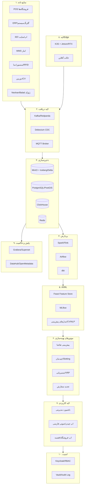

# مگاپروپوزال جامع پلتفرم هوشمند انبار و زنجیره تأمین مبتنی بر هوش مصنوعی
## برای افق کوروش، اکوسیستم گلرنگ، اکالا و گلرنگ‌پخش — هم استقرار داخلی، هم محصول‌سازی برای فروش

> **سند راهبردی غیرمحرمانه | تاریخ مرجع: خرداد ۱۴۰۵ (می ۲۰۲۶) | نسخه ماژولار قابل تقسیم به ۷ سند Word هماهنگ**
>
> این مگاپروپوزال طوری طراحی شده که به هفت مگاماژول قابل تفکیک تبدیل شود: (۱) سند مادر/منشور برنامه؛ (۲) مگاماژول فنی؛ (۳) مگاماژول عملیات و پیاده‌سازی؛ (۴) مگاماژول کسب‌وکار و محصول؛ (۵) مگاماژول قراردادی و حقوقی؛ (۶) مگاماژول مالی؛ (۷) مگاماژول حاکمیت و ریسک. ارجاع‌های متقابل با شناسه ماژول (M1…M7) مشخص شده‌اند.

---

## TL;DR (سه نکته اصلی)

- **مسیر برنده برای ایران، نرم‌افزار هوشمند است نه روباتیک سنگین.** به دلیل دستمزد پایین نیروی کار ایران نسبت به غرب، دوره بازگشت سرمایه روباتیک (که در غرب ۱۸ ماه تا ۵ سال است) در ایران به‌شدت طولانی می‌شود؛ در مقابل، پیش‌بینی تقاضا، بهینه‌سازی چیدمان (Slotting)، هدایت چیدن (Pick Path) و مسیریابی ناوگان (TMS) با سرمایه اندک و در ۳ تا ۶ ماه نتیجه می‌دهند. توصیه قاطع: ابتدا «مغز نرم‌افزاری» ساخته شود، سپس به‌صورت تدریجی و مبتنی بر ROI اثبات‌شده به سمت سخت‌افزار حرکت شود.
- **هدف دوگانه قابل تحقق است: افق/گلرنگ هم کاربر است، هم باید شرکت محصول‌محور شود.** همان پلتفرمی که برای ۳۰ انبار و بیش از ۴٬۴۰۰ فروشگاه افق کوروش ساخته می‌شود، با لایه‌بندی چندمستأجری (Multi-tenant) و مدل SaaS/لایسنس می‌تواند به خرده‌فروشی‌های زنجیره‌ای، توزیع‌کنندگان FMCG، داروپخش‌ها، زنجیره سرد و 3PLهای ایران و منطقه (عراق، که افق در حال افتتاح شعب در آن است) فروخته شود. این دقیقاً مسیری است که اکادو (از خرده‌فروش به لایسنس‌دهنده فناوری) و JD Logistics (۷۰٪ درآمد از مشتریان خارجی) طی کردند.
- **معماری باید «آفلاین‌محور، متن‌باز و خوداتکا» باشد.** تحریم (ابرآروان تحت تحریم OFAC و EU)، قطعی‌های مکرر اینترنت و بی‌ثباتی اقتصادی، استقرار on-prem/private-cloud با پشته متن‌باز (MinIO، Iceberg، Spark، Kafka/Redpanda، Airflow، ClickHouse، PostgreSQL/PostGIS، MLflow، K3s، Keycloak) و قابلیت Edge را به یک الزام تبدیل می‌کند، نه یک گزینه.

---

## مگاماژول ۱ — سند مادر: خلاصه اجرایی، منشور برنامه و معماری کلان

### ۱.۱ بافت سازمانی و مقیاس واقعی (نقطه شروع تصمیم‌گیری)

**اکوسیستم گلرنگ (گروه صنعتی گلرنگ):** گروهی با ریشه در شرکت شیمیایی پاکشو (تأسیس ۱۳۵۱) که به‌صورت گروه از ۱۳۸۲ فعالیت می‌کند و توسط مهدی فضلی (رئیس و مدیرعامل) اداره می‌شود. گروه در **۸ هلدینگ** سازمان‌دهی شده است: گروه سرمایه‌گذاری کوروش (خرده‌فروشی)، هلدینگ غذایی هستی، مهد خاورمیانه، پدیده شیمی پایدار، سرمایه‌گذاری داروسازی گلرنگ، گروه پخش گلرنگ، گروه انرژی نوین و مدیریت سرمایه آرین تدبیر. شمار کارکنان در منابع وابسته به گروه **«بیش از ۴۵٬۰۰۰ نفر»** (و در صفحه‌ای دیگر «بیش از ۵۵٬۰۰۰ نفر») ذکر شده — این تعارض باید در ممیزی فاز صفر راستی‌آزمایی شود. خروجی گروه «بیش از یک میلیارد واحد محصول در سال» و «بیش از ۱۲۰ گروه کالایی (حدود ۳٬۵۰۰ SKU)» اعلام شده است. در بهمن ۱۴۰۲ گروه ۷۰٪ تپسی و ۱۰۰٪ الوپیک را خریداری کرد — که از منظر این پروژه، **مالکیت ناوگان پیک موتوری (الوپیک) یک دارایی راهبردی برای کوئیک‌کامرس و تحویل آخرین‌مایل اکالا است**.

**افق کوروش (نماد بورسی «افق»):** اولین فروشگاه زنجیره‌ای واردشده به بازار سرمایه ایران (۱۳۹۷). نخستین شعبه ۹ آذر ۱۳۹۲ افتتاح شد. مسیر رشد شعب: ۲٬۳۶۱ شعبه (دی ۱۳۹۹) ← با افتتاح شعبه «بندرعباس صادقیه» در آبان ۱۴۰۳ به **۴٬۰۰۰ فروشگاه در ۳۱ استان و ۶۷۵ شهر، با ۲۰ هزار نیروی انسانی و بیش از ۱۴ میلیون مشتری** رسید (صمت‌نیوز) ← و سپس با افتتاح هزارمین فروشگاه سال در اسفند ۱۴۰۳ به **«بیش از ۴٬۴۰۰ فروشگاه در ۷۰۶ شهر»** (دنیای اقتصاد). فروش سال ۱۴۰۱ معادل ۳۵٬۸۲۰ میلیارد تومان و سال ۱۴۰۲ معادل ۶۶٬۲۹۹ میلیارد تومان (رشد ۸۵٪ سود خالص).

**زیرساخت لجستیکی افق (تأییدشده از چند منبع):** طبق معرفی رسمی افق کوروش (e-estekhdam.com): **«افق کوروش روزانه ۳ هزار تن کالا را مستقیماً در ۳۰ انبار با ۱۵۰ هزار مترمربع دریافت و با ۶۰۰ ماشین حمل می‌کند.»** در مصاحبه اجرایی (عصرایران) تصریح شده: **«۳۰ انبار سراسری — ۱۱ سردخانه‌ای + ۱۹ خشک — در استان‌های مختلف.»** نکته تعارض منابع: دنیای اقتصاد در جایی فضای انبار را ~۱۰۰٬۰۰۰ مترمربع و تناژ روزانه را ۶٬۰۰۰ تن ذکر کرده — هر دو رقم باید در ممیزی راستی‌آزمایی شوند؛ اما ارقام «۳۰ انبار / ۱۱ سرد + ۱۹ خشک / ۶۰۰ کامیون» در منابع سازگارند.

**اکالا (توسعه تجارت الکترونیک کوروش):** سوپرمارکت آنلاین گروه از ۱۳۹۶. **رکورد عملیاتی کلیدی** که محرک اصلی این پروژه است: طبق روابط‌عمومی اکالا (رویداد۲۴/خبرفوری، آبان ۱۴۰۴)، **«اُکالا در روز ۲۹ آبان ۱۴۰۴ در پی کمپین رایگان می‌رسونمش با ثبت ۲۴۶ هزار و ۱۰۲ سفارش به فروش ۱۴۰ میلیارد تومانی در یک روز دست یافت»** — با پردازش **۱۰ سفارش در ثانیه** در ساعات اوج، رشد ترافیک ۷۳٪، تحویل موفق بیش از ۹۷٪، و همکاری ۱۲ هزار سفیر الوپیک و ۳٬۲۵۰ سوپرمارکت در ۲۴۸ شهر از ۳۱ استان (رکورد قبلی ۲۱۲ هزار سفارش در ۲ اسفند ۱۴۰۳). صورت‌های مالی حسابرسی‌شده اکالا (۶ ماهه منتهی به شهریور ۱۴۰۳): درآمد عملیاتی ۲۲۶.۵ میلیارد تومان (حدود ۲ برابر سال قبل)؛ سهم کارمزد اکالا حدود ۷٪ از هر فروش آنلاین. **تفسیر مدیریتی:** رشد ۱۰ سفارش/ثانیه و الگوی اوج کمپینی به این معناست که گلوگاه اصلی، نه «نمایش وب‌سایت» بلکه **هماهنگی موجودی فروشگاه-انبار، تخصیص سفیر، و دقت چیدن سفارش (Order Picking)** در سطح فروشگاه است — دقیقاً جایی که نرم‌افزار هوشمند بیشترین اثر را دارد.

**گلرنگ سیستم (بازوی IT گروه):** تأسیس ۱۳۹۳ با حدود **۴۰۰ نفر**؛ محصولاتی نظیر GNG Plus (سیستم یکپارچه فرایندهای سازمانی، رونمایی خرداد ۱۴۰۴)، پیاده‌سازی ERP مایکروسافت و SAP، پلتفرم هوش مصنوعی «گیو»، دستیار مبتنی بر LLM «هوشیار»، فرایندکاوی «فراکاو» و محصول کارخانه هوشمند «Xonnect». **پیامد راهبردی حیاتی:** گلرنگ سیستم باید **شریک پیاده‌ساز داخلی و مالک معماری یکپارچه‌سازی (Integration)** این پلتفرم باشد؛ این کار هم وابستگی به پیمانکار خارجی را حذف می‌کند، هم پایه «شرکت محصول‌محور» را می‌سازد (گلرنگ سیستم می‌تواند کانال فروش و واحد خدمات حرفه‌ای محصول شود).

### ۱.۲ معماری کلان (نمای مفهومی ۱۰ لایه)

---

## مگاماژول ۲ — مگاماژول فنی: معماری، سخت‌افزار، نرم‌افزار، مدل‌های AI، MLOps، Edge

### ۲.۱ تحلیل شرکت‌های جهانی (مرجع فنی و الگوبرداری)

| شرکت | مسئله حل‌شده | فناوری/معماری | نتیجه کسب‌وکاری | قابل کپی برای ایران؟ | نسخه اقتصادی برای افق |
|---|---|---|---|---|---|
| **Amazon Robotics** | جابه‌جایی قفسه، چیدن، مرتب‌سازی | بیش از ۱M ربات در >۳۰۰ مرکز؛ مدل هوش مصنوعی DeepFleet برای هماهنگی ناوگان؛ آغاز با خرید Kiva در ۲۰۱۲ | بهبود ۱۰٪ زمان جابه‌جایی ناوگان با DeepFleet؛ کاهش تا ۲۵٪ زمان پردازش در سایت Shreveport | خیر (CAPEX/تحریم) | فقط الگوریتم هماهنگی ناوگان پیک/AGV سبک |
| **Ocado** | چیدن گروسری با حجم بالا | گرید مکعبی، ربات Hummingbird (تا ۴ متر/ثانیه)، بازوی OCADEX با یادگیری تقویتی، دیجیتال‌توین | به‌گفته مدیرعامل Ocado: «یک CFC سفارش ۴۵–۵۰ قلمی را در حدود ۱۰ دقیقه کار انسانی آماده می‌کند»؛ on-time dispatch تا ۹۹٪ | خیر (هزینه CFC ۲۰۰–۳۰۰M دلار، بازگشت ۵–۸ سال) | فقط مفهوم دیجیتال‌توین و الگوریتم موج‌بندی سفارش |
| **JD.com** | fulfillment بدون سرنشین | انبار Asia No.1، الگوریتم اعزام ربات (Integer Programming)، ASRS چندشاتل | دقت مرتب‌سازی ۹۹.۹۹٪؛ نسبت هزینه fulfillment به سطح جهانی ۶.۵٪؛ ۹۰٪ سفارش‌ها same/next-day | خیر برای سخت‌افزار / بله برای الگوریتم بهینه‌سازی | موتور بهینه‌سازی تخصیص و موج‌بندی (متن‌باز/OR-Tools) |
| **Walmart** | پیش‌بینی تقاضا، موجودی | ML سری‌زمانی در سطح store-SKU-day، AI عامل‌محور (Agentic) | کاهش ۱۶٪ stockout، بهبود ۱۰٪ گردش موجودی، کاهش ۱۰٪ هزینه لجستیک (موارد گزارش‌شده در مطالعات موردی ثالث) | **بله — اولویت اول** | هسته پیش‌بینی تقاضای محلی‌شده |
| **DHL** | تخلیه/جابه‌جایی | بیش از ۷٬۵۰۰ ربات؛ Stretch بوستون‌داینامیکس (۷۰۰ بسته/ساعت، تا ۲۳ کیلو)؛ Locus AMR | >۹۰٪ انبارها حداقل یک راهکار اتوماسیون | جزئی (Locus AMR در فاز پیشرفته) | مدل RaaS برای انبار مرکزی منتخب |
| **AutoStore** | تراکم ذخیره‌سازی | گرید مکعبی، نرم‌افزار Router | دقت ۹۹.۸٪؛ ROI معمولاً زیر ۵ سال (طبق Swisslog) | محدود (واردات سخت‌افزار) | فقط برای یک انبار high-value دارویی/آرایشی |
| **Locus/Geek+** | بهره‌وری چیدن | AMR + LocusONE/RaaS | افزایش ۲–۳ برابری بهره‌وری چیدن | بله در فاز پیشرفته با تأمین چینی | پایلوت AMR چینی در یک DC |

### ۲.۲ سه سطح طراحی انبار (انتخاب بر اساس نوع انبار)

| بُعد | سطح ۱: اقتصادی/سریع | سطح ۲: نیمه‌اتوماتیک | سطح ۳: پیشرفته/روباتیک |
|---|---|---|---|
| تجهیزات | بارکدخوان، هندهلد، چاپ لیبل، Wi-Fi صنعتی | + Pick-to-Light، نوار نقاله سبک، چیدن صوتی فارسی | + AMR/ASRS/شاتل، بازوی روباتیک |
| نرم‌افزار | WMS متن‌باز + موتور Slotting/Pick-Path | + WES، CV شمارش | + WCS، دیجیتال‌توین، هماهنگی ناوگان |
| فرایند | چیدن هدایت‌شده | Zone/Batch picking | Goods-to-Person |
| نیروی انسانی | کاهش خطا، بدون کاهش هد | کاهش ۱۵–۲۵٪ مسافت پیمایش | کاهش چشمگیر هد چیدن |
| هزینه نسبی | کم | متوسط | بسیار بالا |
| زمان استقرار | ۸–۱۶ هفته | ۴–۸ ماه | ۱۲–۲۴ ماه |
| مناسب برای | فروشگاه/انبار منطقه‌ای | DC منطقه‌ای، دارک‌استور | انبار مرکزی high-volume |

### ۲.۳ مدل‌ها و الگوریتم‌های AI (شواهد دقت)

برای **پیش‌بینی تقاضا**، شواهد آکادمیک (arXiv 2506.05941) نشان می‌دهد روش‌های ensemble مبتنی بر درخت (LightGBM/XGBoost) در داده خرده‌فروشی هم سریع‌تر و هم کم‌مصرف‌ترند: LightGBM به group revenue WMAPE حدود ۰.۰۶۹ رسید، در حالی‌که Temporal Fusion Transformer (TFT) با وجود دقت بالا (در یک مطالعه دیگر MAPE ۶.۳۲٪ در برابر XGBoost ۱۴.۸۷٪ و LSTM ۱۸.۳۴٪) هزینه محاسباتی به‌مراتب بالاتری دارد (تا ۸GB حافظه و ۵۰ms به ازای هر پیش‌بینی). **توصیه محلی‌شده برای ایران:** خط پایه با LightGBM/XGBoost (سبک، روی CPU یا RTX 4090 داخلی) و استفاده از TFT فقط برای SKUهای high-value یا افق بلندمدت. این انتخاب مستقیماً با محدودیت GPU تحت تحریم سازگار است.

سایر کاربردها: **چیدمان (Slotting)** با بهینه‌سازی ترکیبی و تحلیل ABC/همبستگی سبد؛ **مسیریابی (VRP)** با OR-Tools؛ **بینایی ماشین** برای شمارش/کنترل کیفیت با YOLO روی Jetson/RTX؛ **NLP فارسی** برای چیدن صوتی.

### ۲.۴ سخت‌افزار: ۲۰+ قلم با امکان‌سنجی تأمین در ایران

| قلم | کاربرد | قیمت/تأمین ایران | جایگزین اقتصادی | اولویت |
|---|---|---|---|---|
| RTX 4090 (۲۴GB) | آموزش/استنتاج ML سنگین | ASUS ROG Strix RTX 4090 معادل ۱۲۸٬۹۹۵٬۰۰۰ تومان (لاین کامپیوتر)؛ بازه تا ۱۶۳٬۵۹۰٬۰۰۰ تومان | اجاره GPU داخلی | بالا |
| Jetson Orin Nano 8GB | Edge AI/CV (تا ۶۷ TOPS) | Developer Kit از ۵۳٬۸۱۰٬۰۰۰ تومان (ترب/کالاپی) تا ۷۱٬۵۳۷٬۰۰۰ تومان | Orange Pi + NPU راکچیپ | بالا |
| Jetson AGX Orin 64GB | Edge سنگین | کیت ۱۹۹٬۰۰۰٬۰۰۰ تومان (ISEE) | چند Orin Nano | متوسط |
| سرور GPU اجاره‌ای A4000 | استنتاج ابری داخلی | Novin Host: ۴۴٬۱۰۰٬۰۰۰ تومان/ماه | Ferdowsi Cloud RTX 3090 ~۲۹٬۰۰۰ تومان/ساعت | بالا |
| بارکدخوان/هندهلد صنعتی | چیدن/دریافت | تأمین داخلی (چینی/ترک) | — | بالا |
| دوربین IP/صنعتی | CV قفسه/کنترل کیفیت | تأمین داخلی فراوان | — | متوسط |
| Edge Box (K3S) | اجرای آفلاین | مونتاژ داخلی | Mini-PC صنعتی | بالا |
| تگ/گیت RFID | ردیابی پالت | تأمین داخلی (رای‌دانا/آویژه) | بارکد در فاز اول | متوسط |
| Pick-to-Light | چیدن ناحیه‌ای | واردات/مونتاژ | چیدن صوتی | متوسط |
| AMR چینی (Geek+/مشابه) | جابه‌جایی | واردات چین | RaaS/لیزینگ | پایین (فاز ۵) |
| Wi-Fi/AP صنعتی | شبکه چیدن | تأمین داخلی | — | بالا |
| سنسور دما/رطوبت | زنجیره سرد | تأمین داخلی | — | بالا (۱۱ سردخانه) |

*نکته شفاف: قیمت‌های GPU در ایران به‌شدت نوسانی است؛ ارقام بالا «باند معقول» از خرده‌فروش‌های تهران‌اند و باید در زمان خرید استعلام شوند. اکثر ارائه‌دهندگان GPU داخلی (IranGPU با عرضه A100/L40/H100، پارس‌پک، Lexoya) قیمت ماهانه را استعلامی اعلام می‌کنند.*

### ۲.۵ MLOps و پلتفرم داده
پشته پیشنهادی کاملاً متن‌باز و خوداتکا: MLflow (رهگیری/رجیستری مدل)، Feast (Feature Store)، Airflow (ارکستراسیون)، dbt (تبدیل)، Iceberg/Delta روی MinIO (دریاچه داده)، ClickHouse (تحلیلی)، DataHub/OpenMetadata (کاتالوگ و نسب‌داده)، K3s (Kubernetes سبک برای Edge). این انتخاب‌ها به‌صراحت برای اجتناب از قفل‌شدگی به فروشنده و مقاومت در برابر تحریم انجام شده‌اند.

---

## مگاماژول ۳ — عملیات و پیاده‌سازی: نیازسنجی، SOP، استقرار، آموزش، تغییر

### ۳.۱ متدولوژی نیازسنجی (Discovery) و مدل بلوغ

**پرسشنامه ممیزی وضعیت موجود (نمونه سرفصل‌ها):** کیفیت داده master (SKU، مکان، تامین‌کننده)؛ نرخ دقت موجودی فعلی؛ نرخ خطای چیدن؛ نرخ stockout و overstock؛ درصد ضایعات/انقضا (به‌ویژه ۱۱ سردخانه)؛ زمان چرخه سفارش اکالا؛ یکپارچگی با ERP گلرنگ سیستم؛ پایداری شبکه/برق هر سایت.

**مدل بلوغ انبار (۵ سطح):** ۱) دستی/کاغذی ← ۲) بارکد پایه ← ۳) WMS یکپارچه + داده تمیز ← ۴) هوشمند (پیش‌بینی/چیدمان/CV) ← ۵) خودگردان (دیجیتال‌توین/عامل‌محور). توصیه: اکثر انبارهای افق امروز بین سطح ۲ و ۳ هستند؛ هدف فاز اول رساندن همه به سطح ۳ پایدار است.

### ۳.۲ سه پایلوت ۱۲ هفته‌ای

| پایلوت | هدف | مکان | سخت‌افزار | KPI قبل/بعد | معیار موفقیت |
|---|---|---|---|---|---|
| **A: نرم‌افزار کم‌هزینه** | پیش‌بینی تقاضا + تجدید سفارش خودکار | ۱ انبار منطقه‌ای + ۲۰ فروشگاه | فقط سرور موجود/RTX داخلی | کاهش stockout و overstock | کاهش ≥۱۵٪ stockout، کاهش ≥۱۰٪ موجودی مازاد |
| **B: بینایی ماشین** | شمارش/کنترل کیفیت ورودی + پایش قفسه | ۱ انبار + ۵ فروشگاه | Jetson Orin + دوربین IP | دقت شمارش، سرعت دریافت | دقت ≥۹۸٪، کاهش زمان دریافت ≥۲۰٪ |
| **C: نیمه‌اتوماتیک** | چیدن صوتی فارسی + Pick-to-Light | ۱ دارک‌استور اکالا | هدست + PTL | UPH، نرخ خطای چیدن | افزایش ≥۲۰٪ UPH، خطا <۰.۵٪ |

### ۳.۳ عملیاتی‌سازی (Hypercare و مقیاس‌دهی)
پلی‌بوک تبدیل پایلوت به تولید: تثبیت داده master ← go-live محدود ← دوره hypercare ۴–۶ هفته‌ای با تیم آماده‌باش ← آموزش مربیان (Train-the-Trainer) ← مقیاس‌دهی موجی به سایر سایت‌ها بر اساس KPI اثبات‌شده.

---

## مگاماژول ۴ — کسب‌وکار و محصول‌سازی: استراتژی، فروش، قیمت‌گذاری، GTM

### ۴.۱ ساختار محصول و قیمت‌گذاری WMS جهانی (مرجع طراحی محصول)
بازار WMS دو مدل قیمت‌گذاری اصلی دارد: **لایسنس دائمی** (on-prem، مید‌مارکت ۱۰۰K–۵۰۰K دلار، Tier-1 معادل ۵۰۰K–۲M+ دلار، با نگهداری سالانه ۱۵–۲۲٪) و **اشتراک SaaS** (پایه ۱۰۰–۲۰۰ دلار/کاربر/ماه؛ سازمانی تا ۵۰۰+ دلار/کاربر). Manhattan و Blue Yonder قیمت را منتشر نمی‌کنند؛ پیاده‌سازی سازمانی معمولاً ۲۰۰K–۱M+ دلار و ۶–۱۲ ماه. Blue Yonder روی SaaS سه‌سطحی (Basic/Pro/Enterprise) با TCO سه‌ساله ۵۰۰K تا چند میلیون دلار. **درس برای افق:** محصول باید ماژولار و سطح‌بندی‌شده باشد تا هم به مشتری کوچک (یک انبار) و هم بزرگ (چند DC) فروخته شود.

### ۴.۲ اقتصاد شرکت محصول‌محور (متریک‌های SaaS)
بنچمارک‌های سالم: **LTV:CAC ≥ ۳:۱**، **حاشیه ناخالص اشتراک ۷۵–۸۵٪** (میانه Benchmarkit 2023: ۷۹٪)، **بازگشت CAC < ۱۲ ماه**، **NRR > ۱۰۰٪**، و **Rule of 40** (رشد + سود ≥۴۰٪). نسبت خدمات حرفه‌ای به لایسنس باید مدیریت شود (حاشیه خدمات ۲۰–۳۵٪). **محلی‌سازی برای ایران:** قیمت‌گذاری ریالی با بند تعدیل تورمی/ارزی، مدل per-site یا per-transaction (هماهنگ با مدل کارمزدی ۷٪ اکالا) به‌جای per-user، و ارائه RaaS برای سخت‌افزار جهت تبدیل CAPEX مشتری به OPEX.

### ۴.۳ بازارهدف و Go-to-Market در ایران
بخش‌های هدف: زنجیره‌های خرده‌فروشی، توزیع‌کنندگان FMCG (که گلرنگ‌پخش/گلپخش‌اول خود نمونه داخلی‌اند)، داروپخش‌ها، زنجیره سرد، و 3PLها. کانال: گلرنگ سیستم به‌عنوان مجری/فروشنده، مدل reseller و system-integrator. حرکت فروش: pilot-to-scale (همان پایلوت‌های داخلی به‌عنوان مرجع فروش). بازار منطقه‌ای: عراق (هم‌راستا با افتتاح شعب افق در عراق).

### ۴.۴ ماتریس Build/Buy/Partner/White-label (۲۰ مؤلفه — نمونه)

| مؤلفه | تصمیم | دلیل (فنی/اقتصادی/تحریم/محصول) |
|---|---|---|
| موتور پیش‌بینی تقاضا | **Build** | مزیت رقابتی محصول؛ داده اختصاصی؛ قابل فروش |
| هسته WMS | Build روی پایه متن‌باز | قفل‌نشدگی + قابل محصول‌سازی |
| پلتفرم داده | Buy (متن‌باز/self-host) | بلوغ کافی، صرفه |
| TMS/مسیریابی | Build (OR-Tools) | ژئوکد فارسی (نشان/بلد)، قابل فروش |
| AMR/ASRS | Partner/White-label (چینی) | تحریم واردات؛ تمرکز روی نرم‌افزار |
| چیدن صوتی فارسی | Build (Vosk/Whisper) | نبود راهکار آماده فارسی on-prem |
| داشبورد BI | Buy (Superset/Grafana) | صرفه |
| ابر | Self-host/Private | تحریم AWS/Azure/Arvan |

---

## مگاماژول ۵ — قراردادی و حقوقی: MSA/SOW/SLA، RFP/RFQ، IP، فروشنده

### ۵.۱ ساختار قراردادها
**MSA (قرارداد مادر خدمات):** تعاریف، مالکیت معنوی، محرمانگی، مسئولیت، فورس‌ماژور (شامل قطعی برق/اینترنت و تحریم)، حل اختلاف. **SOW (شرح کار):** دامنه، تحویلی‌ها، جدول زمانی، معیار پذیرش، نرخ تغییر. **SLA:** سطوح uptime، زمان پاسخ/حل به تفکیک شدت، جریمه/اعتبار، پنجره نگهداری.

### ۵.۲ طراحی SLA (داخلی و محصولی)

| سطح | Uptime | زمان پاسخ بحرانی | زمان حل | پشتیبانی |
|---|---|---|---|---|
| L1 (Help Desk) | — | ۱۵ دقیقه | تریاژ | داخلی/محصول |
| L2 (Application) | ۹۹.۵٪ | ۱ ساعت | ۴ ساعت | تیم محصول |
| L3 (Core/AI) | ۹۹.۹٪ | ۳۰ دقیقه | بر اساس قرارداد | مهندسی هسته |

### ۵.۳ مالکیت معنوی و لایسنس
هنگام ساخت داخلی، IP متعلق به افق/گلرنگ؛ برای فروش محصول، EULA و مدل لایسنس تجاری. **انطباق لایسنس متن‌باز حیاتی است:** Apache/MIT اجازه استفاده تجاری بدون الزام انتشار کد را می‌دهند (مناسب محصول فروختنی)، اما GPL/AGPL ممکن است الزام افشای کد ایجاد کند — باید در محصول قابل‌فروش از کامپوننت‌های copyleft قوی در هسته اجتناب یا با وکیل بررسی شود.

### ۵.۴ RFP/RFQ و مدیریت فروشنده
قالب RFP برای خرید سخت‌افزار (AMR، اسکنر، دوربین، Edge Box، سنسور) با معیارهای ارزیابی: امکان‌سنجی تأمین تحت تحریم، گارانتی/قطعات یدکی، انطباق امنیتی، TCO. شامل بند escrow کد، DPA (قرارداد پردازش داده)، و انطباق تحریمی در همه قراردادها.

---

## مگاماژول ۶ — مالی: CAPEX/OPEX، ROI، سناریوها

### ۶.۱ مفروضات شفاف
نرخ مرجع: **۱ دلار = ۱۴٬۰۰۰٬۰۰۰ ریال (۱٬۴۰۰ هزار تومان)**، قابل تعدیل. زمینه کلان (شفاف): طبق Times of Israel (دسامبر ۲۰۲۵)، اواخر دسامبر ۲۰۲۵ ریال به حدود ۱.۴۲ میلیون per دلار رسید، تورم سرفصل ۴۲٪، نقطه‌به‌نقطه ۵۳٪ و قیمت مواد غذایی +۷۲٪ (Trading Economics تورم اکتبر را ۴۸.۶٪ اعلام کرد). قانون حذف چهار صفر در مهر ۱۴۰۴ تصویب شد (دوره گذار تا سه سال). **پیامد:** مدل مالی باید با بند تعدیل ارزی/تورمی و بازنگری فصلی بسته شود؛ تورم بالا انگیزه پیش‌بینی دقیق موجودی و کاهش احتکار/خرید هراسی را تشدید می‌کند.

### ۶.۲ سه سناریو (مرتبه بزرگی، نه رقم قطعی)

| سناریو | تمرکز | CAPEX نسبی | OPEX سالانه نسبی | منبع صرفه | دوره بازگشت |
|---|---|---|---|---|---|
| حداقلی | نرم‌افزار (پیش‌بینی/چیدمان/WMS) | کم | کم (تیم+زیرساخت) | کاهش stockout/overstock/ضایعات | کوتاه (<۱۸ ماه) |
| متوسط | + CV + چیدن صوتی + TMS | متوسط | متوسط | + سرعت سفارش/SLA اکالا، کاهش خطا | متوسط |
| پیشرفته | + AMR/ASRS انتخابی | بالا | بالا | + کاهش هد چیدن | بلند (به دستمزد حساس) |

منابع صرفه قابل اندازه‌گیری: کاهش نیروی کار، کاهش خطای چیدن، کاهش stockout، کاهش overstock، کاهش ضایعات/انقضا (۱۱ سردخانه)، افزایش سرعت سفارش، کاهش هزینه حمل (TMS)، بهبود SLA اکالا. تحلیل حساسیت روی نرخ ارز، دستمزد و حجم سفارش الزامی است.

---

## مگاماژول ۷ — حاکمیت و ریسک: امنیت، رجیستر ریسک، انطباق، تحریم

### ۷.۱ رجیستر ریسک (نمونه)

| ریسک | احتمال | اثر | نشانه هشدار | پیشگیری | اقدام جبرانی |
|---|---|---|---|---|---|
| داده ضعیف master | بالا | بالا | مغایرت موجودی | پروژه پاک‌سازی فاز صفر | فریز go-live |
| مقاومت کارکنان | متوسط | بالا | پذیرش پایین اپ | مدیریت تغییر/مربی | مشوق/گیمیفیکیشن |
| تحریم/تأمین قطعات | بالا | بالا | تأخیر واردات | تأمین داخلی/چینی، RaaS | جایگزین متن‌باز |
| قطعی اینترنت/برق | بالا | متوسط | افت اتصال | معماری آفلاین/Edge | صف محلی + همگام‌سازی |
| ابر تحریم‌شده (Arvan) | قطعی | بالا | — | Private/self-host | اجتناب کامل |
| ROI پایین روباتیک | بالا | متوسط | بازگشت طولانی | اولویت نرم‌افزار | توقف فاز سخت‌افزار |
| حریم خصوصی CV | متوسط | متوسط | شکایت کارکنان | ناشناس‌سازی/سیاست | حذف داده چهره |

### ۷.۲ استانداردها و امنیت
SOPهای جدید، حاکمیت داده و مدل، رمزنگاری، RBAC (Keycloak)، Audit Log (Vault)، Backup/DR، حالت آفلاین، مدیریت رخداد، و مدیریت فروشنده. انطباق تحریمی در همه قراردادها و اجتناب صریح از سرویس‌های تحریم‌شده (ابرآروان تحت OFAC از ۲ ژوئن ۲۰۲۳ و EU از نوامبر ۲۰۲۲).

---

## بسته تصمیم اجرایی (Executive Decision Pack)

**۵ تصمیم مدیرعامل:** (۱) تأیید اولویت نرم‌افزار بر روباتیک؛ (۲) انتصاب گلرنگ سیستم به‌عنوان مجری/مالک یکپارچه‌سازی و کانال محصول؛ (۳) تصویب معماری on-prem/متن‌باز؛ (۴) تأیید هدف دوگانه (داخلی + محصول فروختنی)؛ (۵) تخصیص بودجه فاز صفر+یک.

**۵ سرمایه‌گذاری ضروری:** پلتفرم داده متن‌باز؛ تیم Data/ML؛ پاک‌سازی داده master؛ GPU داخلی/اجاره‌ای؛ WMS هسته.

**۵ پیروزی سریع:** پیش‌بینی تقاضا؛ تجدید سفارش خودکار؛ بهینه‌سازی چیدمان؛ داشبورد مدیریتی؛ چیدن هدایت‌شده.

**۵ پروژه بلندمدت:** TMS/مسیریابی؛ CV قفسه/کیفیت؛ دیجیتال‌توین؛ AMR انتخابی؛ محصول SaaS چندمستأجری.

**۵ کاری که نباید کرد:** خرید روباتیک سنگین زودهنگام؛ اتکا به ابر تحریم‌شده؛ قفل‌شدگی به فروشنده؛ شروع بدون داده تمیز؛ کپی کور Ocado/Amazon.

**۱۰ KPI موفقیت:** دقت موجودی، نرخ stockout، نرخ overstock، ضایعات/انقضا، UPH، نرخ خطای چیدن، زمان چرخه سفارش اکالا، on-time delivery، MAPE پیش‌بینی، و (برای محصول) ARR/NRR.

**نقطه شروع نهایی:** پایلوت A (نرم‌افزار کم‌هزینه) در یک انبار منطقه‌ای + ۲۰ فروشگاه، موازی با پروژه پاک‌سازی داده master و راستی‌آزمایی ارقام انبار (۱۵۰K در برابر ۱۰۰K مترمربع؛ ۳K در برابر ۶K تن).

---

*این سند بر پایه منابع عمومی معتبر و داده‌های اعلامی شرکت‌ها تدوین شده است. در مواردی که ارقام میان منابع متعارض بوده‌اند (شمار کارکنان گلرنگ، مساحت/تناژ انبار افق)، تعارض صریحاً علامت‌گذاری شده و راستی‌آزمایی در فاز صفر توصیه شده است. ارقام مالی به‌صورت مرتبه‌بزرگی و با مفروضات شفاف ارائه شده‌اند، نه اعداد قطعی ساختگی.*