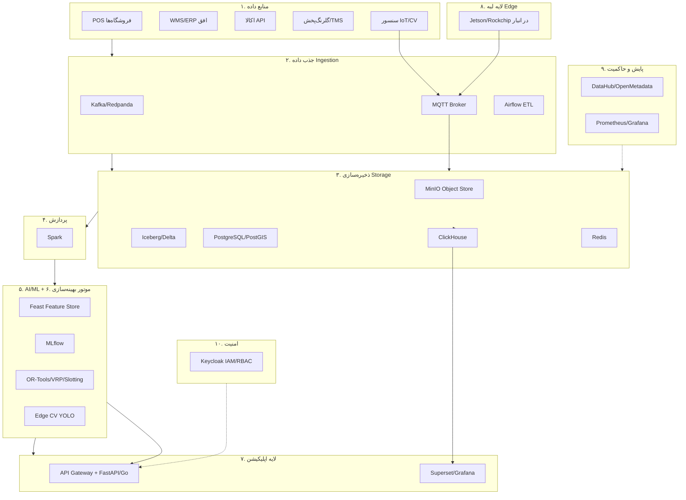

# گزارش مشاوره‌ای و طرح فنی و اجرایی جامع
## «انبار و زنجیره‌تأمین هوشمند مبتنی بر هوش مصنوعی با فناوری‌های پیشرفته روز دنیا»
### طرح بومی‌سازی و پیاده‌سازی برای افق کوروش، اکوسیستم گلرنگ، اکالا و گلرنگ‌پخش

سند تهیه‌شده برای: مدیرعامل گروه، معاون لجستیک، معاون فناوری، تیم گلرنگ‌سیستم، تیم اکالا، مدیران انبار و سرمایه‌گذاران
طبقه‌بندی: غیرمحرمانه | واحد پول: ریال ایران | تاریخ مرجع: خرداد ۱۴۰۵ (می ۲۰۲۶)

> **مفروضه نرخ ارز (شفاف و قابل‌تنظیم):** در سراسر این سند، نرخ مرجع **۱ دلار = ۱٬۴۰۰٬۰۰۰ ریال (۱۴۰٬۰۰۰ تومان)** بر اساس نرخ بازار آزاد اواخر ۲۰۲۵ به‌کار رفته است. منبع: گزارش‌های Iran International و ویکی‌پدیا که افت ریال از ۴۳۰٬۰۰۰ ریال (۲۰۲۲) به حدود ۱٬۴۲۰٬۰۰۰ ریال (دسامبر ۲۰۲۵) و تورم ۴۲٪ را تأیید می‌کنند. به‌دلیل نوسان شدید، تمام ارقام ریالی باید با **ضریب تعدیل ارز در زمان تصمیم‌گیری** بازمحاسبه شوند؛ از این رو ارقام کلیدی به‌صورت موازی به دلار نیز ارائه شده‌اند. مجلس ایران در ۵ اکتبر ۲۰۲۵ حذف چهار صفر (۱ تومان جدید = ۱۰٬۰۰۰ ریال فعلی) را تصویب کرد؛ ارقام این سند به ریال فعلی است.

---

## فهرست مطالب
۱. خلاصه مدیریتی و ۱۰ ایده برتر اولویت‌بندی‌شده
۲. بنچ‌مارک جهانی (تحلیل تفکیکی هر شرکت)
۳. نقشه زنجیره ارزش انبار هوشمند
۴. ایده‌های سخت‌افزاری قابل‌اجرا
۵. ایده‌های نرم‌افزاری و هوش مصنوعی (۳۰ مورد)
۶. معماری کلان پیشنهادی
۷. معماری فنی انبار در سه سطح
۸. طراحی سه پایلوت اجرایی
۹. نقشه‌راه ۳۶ ماهه
۱۰. ماتریس ساخت/خرید/مشارکت
۱۱. تحلیل هزینه و بازگشت سرمایه (ROI)
۱۲. ساختار تیم و سازمان
۱۳. ثبت ریسک و کنترل‌ها
۱۴. استانداردها و الزامات اجرا
۱۵. بسته تصمیم نهایی مدیریتی
— منابع و مراجع

---

# بخش ۱: خلاصه مدیریتی

## ۱-۱. چرا انبار هوشمند برای افق کوروش یک ضرورت راهبردی است؟

افق کوروش امروز شبکه‌ای از **حدود ۴٬۴۰۰ فروشگاه در ۶۸۶ شهر** (منبع: ویکی‌پدیای فارسی، اردیبهشت ۱۴۰۴) را با **۳۰ انبار مرکزی (۱۱ سردخانه‌ای + ۱۹ خشک)**، ناوگانی حدود **۶۰۰ کامیون** و جابه‌جایی روزانه نزدیک به **۳٬۰۰۰ تن کالا** (به نقل از مهدی بهمن‌آبادی، معاون برنامه‌ریزی، در گفت‌وگو با همشهری‌آنلاین و دنیای‌اقتصاد) اداره می‌کند. در لایه آنلاین، اکالا با **۲۴۶٬۱۰۲ سفارش در یک روز** (۲۹ آبان ۱۴۰۴، کمپین «رایگان می‌رسونمش» به نقل از رضا عباسی، معاون بازاریابی اکالا در زومیت/دیجیاتو)، حضور در **۲۴۸ شهر** و **بیش از ۲۲ میلیون کاربر** به یکی از بزرگ‌ترین سوپرمارکت‌های آنلاین کشور بدل شده است.

این مقیاس در کنار **شرایط تورمی (تورم ۴۲٪، رشد ۷۲ درصدی قیمت مواد غذایی)** و **رفتار مصرفی پرنوسان (ذخیره‌سازی خانوار، خرید هراسی)** یک واقعیت می‌سازد: **هر یک درصد بهبود در دقت پیش‌بینی تقاضا، کاهش موجودی راکد، یا کاهش ضایعات، معادل ده‌ها میلیارد ریال در سال است.** برخلاف غرب که هزینه نیروی کار بالا، ربات‌های سنگین را توجیه می‌کند، در ایران **مزیت اصلی در نرم‌افزار هوشمند کم‌هزینه (پیش‌بینی، چیدمان، مسیر برداشت، بینایی ماشین) است، نه اتوماسیون رباتیک سنگین.**

## ۱-۲. کجاست فرصت اصلی؟

| محور فرصت | مشکل فعلی محتمل | اهرم ارزش سالانه (برآوردی) |
|---|---|---|
| کاهش موجودی راکد و سرمایه در گردش | پیش‌بینی سنتی، صفرهای ایمنی ثابت | آزادسازی ۸–۱۵٪ سرمایه در گردش انبار |
| کاهش Stock-out (نبود کالا در قفسه) | عدم رؤیت لحظه‌ای قفسه | افزایش فروش ۱–۳٪ در اقلام پوشش‌داده‌شده |
| کاهش خطای برداشت (Picking) | فرایند کاغذی/RF | کاهش خطا تا ۵۰–۹۰٪ با Voice/PTL |
| کاهش ضایعات و انقضا (Perishables) | مدیریت دستی FEFO | کاهش ضایعات ۲۰–۴۰٪ در اقلام فاسدشدنی |
| بهینه‌سازی نیروی کار | برنامه‌ریزی شهودی | افزایش بهره‌وری ۱۵–۳۵٪ در برداشت |
| کاهش هزینه حمل | مسیریابی دستی | کاهش ۱۲–۱۸٪ کیلومتر طی‌شده |
| ارتقای SLA اکالا | برداشت فروشگاه‌محور | افزایش نرخ تحویل موفق و سرعت |

## ۱-۳. ده ایده برتر قابل‌اجرا برای ایران (اولویت‌بندی‌شده)

امتیازدهی: اثر مالی (۱–۵)، پیچیدگی (۱–۵، کمتر=بهتر)، زمان اجرا، اولویت کل.

| رتبه | ایده | اثر مالی | پیچیدگی | زمان اجرا | اولویت |
|---|---|---|---|---|---|
| ۱ | موتور پیش‌بینی تقاضای تورم‌آگاه (Inflation-aware Forecasting) | ۵ | ۲ | ۳–۶ ماه | **بحرانی** |
| ۲ | بهینه‌سازی چیدمان پویا + مسیر برداشت (Slotting + Pick-path) | ۴ | ۲ | ۳–۵ ماه | **بحرانی** |
| ۳ | تکمیل خودکار موجودی و صفر ایمنی پویا (Auto-replenishment) | ۵ | ۳ | ۴–۷ ماه | **بحرانی** |
| ۴ | شمارش موجودی و تشخیص قفسه خالی با بینایی ماشین لبه‌ای (Edge CV) | ۴ | ۳ | ۴–۶ ماه | بالا |
| ۵ | مدیریت انقضا و ضایعات + بهینه‌سازی Markdown | ۴ | ۲ | ۳–۵ ماه | بالا |
| ۶ | بهینه‌سازی مسیر TMS برای گلرنگ‌پخش و اکالا (VRP) | ۴ | ۳ | ۴–۷ ماه | بالا |
| ۷ | لایه هوشمندی روی WMS + موج/دسته‌بندی برداشت اکالا (Batching) | ۳ | ۳ | ۵–۸ ماه | متوسط |
| ۸ | داشبورد اجرایی + دستیار دانش GenAI فارسی برای SOP و آموزش | ۳ | ۲ | ۳–۵ ماه | متوسط |
| ۹ | Pick-to-Light / Voice Picking فارسی در یک انبار منطقه‌ای | ۳ | ۳ | ۶–۹ ماه | متوسط |
| ۱۰ | ایمنی و ضدسرقت با دوربین (تشخیص کلاه‌ایمنی/تصادف لیفتراک) | ۲ | ۳ | ۴–۶ ماه | پایین‌تر |

**توصیه نهایی نقطه شروع:** ایده‌های ۱، ۲، ۳ و ۴ به‌صورت موازی در یک انبار منطقه‌ای پایلوت و ۵۰ فروشگاه منتخب. این بسته «نرم‌افزار-محور و کم‌سرمایه» بیشترین ROI را با کمترین ریسک تحریم و سرمایه ارزی دارد.

---

# بخش ۲: بنچ‌مارک جهانی

> **درس کلان و هشدار اپیستمیک:** بزرگ‌ترین درس ۲۰۲۵–۲۰۲۶ این است که حتی غول‌ها از اتوماسیون رباتیک متمرکزِ سنگین عقب‌نشینی تاکتیکی کرده‌اند: کروگر شبکه CFC اوکادو را کوچک کرد و چند مرکز را بست (منبع: Grocery Dive، Supply Chain Dive). این تأییدی مستقیم بر استراتژی پیشنهادی ما برای ایران است: **«انعطاف و نرم‌افزار، ROI واقعی است؛ نه بتن و فولاد رباتیک.»**

## ۲-۱. Amazon / Amazon Robotics
- **مسئله حل‌شده:** سرعت و دقت آماده‌سازی در مقیاس عظیم، کاهش پیاده‌روی نیروی کار.
- **فناوری/معماری:** بیش از **۱ میلیون ربات** در شبکه (۷۵۰٬۰۰۰+ تا ۲۰۲۳)؛ سیستم Sequoia (ذخیره‌سازی کانتینری + بازوهای رباتیک + بینایی ماشین)، بازوها Sparrow/Cardinal/Robin، AMR به‌نام Proteus.
- **نتایج گزارش‌شده (منبع مستقیم):** Sequoia «شناسایی و ذخیره موجودی را تا ۷۵٪ سریع‌تر» می‌کند (aboutamazon.com). به‌گفته Scott Dresser (معاون Amazon Robotics، خبرگزاری آمازون ۱ ژوئیه ۲۰۲۵): مدل نسل بعد «انتظار می‌رود بهره‌وری را در سایت‌های نسل‌جدید ۲۵٪ افزایش دهد» و هوش مصنوعی DeepFleet «زمان سفر ناوگان رباتیک را ۱۰٪ بهبود می‌دهد». سایت Shreveport (افتتاح سپتامبر ۲۰۲۴) با حدود ۱٬۰۰۰ ربات، «۲۵٪ کارکنان کمتر» نیاز دارد و آمازون قصد دارد آن را در **حداقل ۴۰ مرکز دیگر تا پایان ۲۰۲۷** تکرار کند. نکته مهم: سایت‌های پیشرفته «۳۰٪ نیروی کار بیشتر در نقش‌های قابلیت‌اطمینان، نگهداری و مهندسی» می‌طلبند.
- **قابل‌کپی برای ایران؟** خیر در لایه رباتیک (تحریم سخت‌افزار، ارز). **بله** در لایه نرم‌افزار: سیستم برنامه‌ریزی موجودی که «کالای درست را در مرکز نزدیک مشتری» قرار می‌دهد، دقیقاً مدل قابل‌بومی‌سازی برای شبکه ۳۰ انباری افق است.

## ۲-۲. Walmart
- **مسئله:** دقت موجودی و ظرفیت توزیع به فروشگاه‌ها.
- **فناوری:** مشارکت با Symbotic (هوش مصنوعی + رباتیک)؛ توافق **۵۲۰ میلیون دلاری** برای ۴۰۰ مرکز APD؛ Symbotic در تمام مراکز توزیع منطقه‌ای.
- **نتایج (به‌روزرسانی‌شده):** به‌گفته John Furner مدیرعامل والمارت آمریکا (DTC Dispatch، ۲۳ فوریه ۲۰۲۶): «تا پایان سال مالی ۲۰۲۶، حدود ۶۵٪ فروشگاه‌ها از مراکز توزیع خودکار کالا دریافت می‌کنند، بالاتر از کمتر از نیمی در حال حاضر»؛ اتوماسیون «هزینه خالص تحویل هر سفارش در آمریکا را ۴۰٪ کاهش داد». ساختار توافق Symbotic: ۲۰۰ میلیون دلار نقد + تا ۳۵۰ میلیون دلار مشروط، پوشش ۴۲ مرکز منطقه‌ای طی «۸+ سال»؛ سرمایه‌گذاری کلان ۱۴ میلیارد دلاری.
- **درس برای ایران:** والمارت «نرم‌افزار دقت موجودی» را قبل از ربات اولویت داد. شروع از انبار منطقه‌ای و سپس فروشگاه، الگوی درست برای افق است.

## ۲-۳. Ocado (و Kroger)
- **مسئله:** سودآوری خواربار آنلاین با حاشیه نازک و رژیم‌های دمایی مختلف.
- **فناوری:** شبکه سه‌بعدی «The Hive»، ربات‌هایی که **۱۰ بار در ثانیه** با سیستم کنترل هوشمند ارتباط دارند؛ سفارش ۵۰ قلمی در **حدود ۵ دقیقه**؛ CFC تا **۷۸٪ بیش از یک سوپرمارکت معمولی** کالا نگه می‌دارد و **۵۰٬۰۰۰+ SKU**؛ برداشت رباتیک نیروی کار دستی را **۵۰٪** کاهش می‌دهد.
- **هشدار حیاتی (Kroger):** کروگر CFC مونرو (۵۵ میلیون دلار، فروش ماژول ۸۰–۱۰۰ میلیون دلار) را ساخت اما در ۲۰۲۵ چند مرکز و spoke را بست و به مدل «hub-and-spoke نزدیک به مشتری» بازگشت (منبع: Grocery Dive، Chain Store Age). *(یادداشت: رقم جریمه ۳۵۰ میلیون دلاری کروگر به اوکادو در منابع به‌طور قطعی تأیید نشد و باید پیش از استناد بازبینی شود؛ تنها رقم ۳۵۰ میلیون دلاری تأییدشده، پرداخت مشروط والمارت به Symbotic است.)*
- **درس برای ایران:** اتوماسیون رباتیک متمرکز پرسرمایه، در بازار پرنوسان ریسک بالایی دارد. مدل **فروشگاه‌محور اکالا (که هم‌اکنون اجرا می‌شود) از منظر ریسک، درست‌تر از ساخت CFC غول‌پیکر است.**

## ۲-۴. JD.com
- **مسئله:** تحویل same/next-day در مقیاس چین.
- **فناوری:** پارک لجستیک Kunshan «Asia No.1» با **بیش از ۸۰ خط سورت و ناوگان ۱۰٬۰۰۰ رباتِ سورت، دقت ۹۹.۹۹٪** و ظرفیت ۴.۵ میلیون بسته در روز (منبع: JD Corporate Blog، ژوئن ۲۰۲۳)؛ انبار کاملاً بدون سرنشین شانگهای. الگوریتم‌های تحقیق در عملیات (Integer Programming) برای زمان‌بندی ربات‌ها.
- **نتایج:** نسبت هزینه تکمیل به سطح جهانی ۶.۵٪ کاهش یافت (مقاله INFORMS 2022)؛ افزایش **پنج‌برابری** بهره‌وری در بخش پوشاک؛ بیش از ۹۳٪ سفارش‌های شرق چین same/next-day.
- **قابل‌بومی‌سازی:** **لایه الگوریتمی (بهینه‌سازی زمان‌بندی و مسیر) کاملاً قابل‌کپی و کم‌هزینه است**؛ سخت‌افزار رباتیک خیر.

## ۲-۵. Alibaba / Cainiao
- **فناوری:** ۱۰۰+ AGV، چارچوب MapReduce برای هماهنگی چندناحیه‌ای، «هوش ازدحامی» (Swarm Intelligence).
- **نتایج:** کاهش **۹۰٪** مسافت پیاده‌روی کارکنان، دقت **۹۹٪** در سورت، افزایش بهره‌وری پرسنل **۳۰٪** (منبع: Tech Wire Asia، Alizila).
- **درس:** بیشترین ارزش از **کاهش پیاده‌روی** می‌آید—که در ایران با نرم‌افزار چیدمان+مسیر بدون ربات هم قابل‌تحقق است.

## ۲-۶. DHL
- **فناوری:** استراتژی چندفروشنده (Locus Robotics، Robust.AI، Boston Dynamics)؛ AMRهای همکار انسان.
- **نتایج (منبع مستقیم DHL/Locus، ۱۴ ژوئن ۲۰۲۴):** «۵۰۰ میلیونیمین برداشت در ۱۸ مه ۲۰۲۴ در مرکز تولدو اسپانیا»؛ استقرار در **بیش از ۳۵ سایت DHL**؛ «۱۰ میلیون برداشت اول ۲.۵ سال طول کشید، اما ۱۰۰ میلیون برداشت آخر تنها ۱۵۴ روز». قرارداد ۲۰۲۳ = **۵٬۰۰۰ ربات Locus Origin**، بزرگ‌ترین قرارداد AMR از نوع خود. AMR بهره‌وری برداشت را دو برابر می‌کند.
- **درس برای ایران:** مدل **AMR اجاره‌ای (RaaS) و همکار-انسان** بدون بازطراحی قفسه، تنها مدل رباتیکی است که شاید در فاز پیشرفته برای افق توجیه‌پذیر شود.

## ۲-۷. Tesco / Costco / Target / 7-Eleven (خلاصه)
- **Tesco:** خاستگاه مفهوم «dark store» (کرویدون، ۲۰۰۹) برای مدیریت سفارش‌های آنلاین خواربار—الگوی مستقیم برای dark store اکالا در کلان‌شهرها.
- **Costco:** مدل کم‌SKU/حجم‌بالا/پالت‌محور—نزدیک به مدل تخفیفی افق با ۱٬۲۰۰–۱٬۵۰۰ SKU؛ تأیید می‌کند چیدمان ساده و گردش بالا، اولویت بهینه‌سازی است نه تنوع.
- **7-Eleven:** شبکه فروشگاه‌های کوچک با تکمیل مکرر—الگوی replenishment پرتکرار برای شبکه فروشگاهی افق.

---

# بخش ۳: نقشه زنجیره ارزش انبار هوشمند

برای هر مرحله: مشکل محتمل فعلی افق → راهکار AI/اتوماسیون → داده موردنیاز → نرم‌افزار → سخت‌افزار → KPI → پیچیدگی → فاز پیشنهادی.

| مرحله | مشکل محتمل افق | راهکار | داده | نرم‌افزار | سخت‌افزار | KPI | پیچیدگی | فاز |
|---|---|---|---|---|---|---|---|---|
| پیش‌بینی تقاضا | مدل سنتی، تورم‌نادیده | TFT/LightGBM تورم‌آگاه | فروش POS، قیمت، تقویم، تورم | Python، MLflow | سرور GPU داخلی | MAPE، WAPE | متوسط | ۱ |
| تأمین/سفارش‌گذاری | تصمیم شهودی خرید | سفارش‌گذاری مبتنی بر AI | پیش‌بینی، Lead-time | موتور بهینه‌سازی | — | نرخ پوشش، موجودی | متوسط | ۲ |
| لجستیک ورودی (Inbound) | زمان‌بندی نامنظم تخلیه | Dock scheduling | ASN، تأمین‌کننده | WMS/Yard | اسکنر، RFID gate | زمان تخلیه | متوسط | ۲ |
| دریافت (Receiving) | شمارش دستی، خطا | اسکن/تونل بارکد، CV | بارکد، وزن | WMS | تونل اسکن، ترازو | دقت دریافت | پایین | ۱ |
| جانمایی (Putaway) | جای ثابت | Putaway هدایت‌شده | ابعاد، گردش | WMS | PDA | زمان جانمایی | پایین | ۲ |
| چیدمان (Slotting) | چیدمان ایستا | Slotting پویا بر گردش | فراوانی برداشت | موتور slotting | — | مسافت برداشت | متوسط | ۱ |
| ذخیره‌سازی | تراکم پایین | بهینه‌سازی فضا | نقشه انبار | WMS | قفسه/AS-RS | بهره‌وری m³ | بالا | ۵ |
| تکمیل (Replenishment) | تأخیر، Stock-out | صفر ایمنی پویا | موجودی لحظه‌ای | موتور replenishment | — | نرخ Stock-out | متوسط | ۲ |
| برداشت (Picking) | کاغذی/RF، خطا | مسیر بهینه + Voice/PTL فارسی | لیست سفارش | WES | هدست/PTL | UPH، دقت | متوسط | ۲–۳ |
| بسته‌بندی (Packing) | بسته‌بندی نامتوازن | پیشنهاد کارتن/کیسه | ابعاد سفارش | الگوریتم cartonization | ترازو | هزینه بسته | پایین | ۳ |
| سورت (Sorting) | دستی | سورتر/منطق دسته‌بندی | مقصد | WES | سورتر/conveyor | دقت سورت | بالا | ۵ |
| اعزام (Dispatch) | بارگذاری غیربهینه | Load planning | حجم، مقصد | TMS | — | پر بودن خودرو | متوسط | ۴ |
| حمل‌ونقل | مسیر دستی | VRP + ETA | آدرس، ترافیک | TMS + Neshan | GPS | کیلومتر/سفارش | متوسط | ۴ |
| تحویل به فروشگاه | بی‌نظمی پنجره زمانی | برنامه‌ریزی پنجره | پنجره تحویل | TMS | — | تحویل به‌موقع | متوسط | ۴ |
| موجودی قفسه | بدون رؤیت لحظه‌ای | CV قفسه خالی + planogram | تصویر قفسه | مدل YOLO | دوربین لبه‌ای | OSA، انطباق | متوسط | ۳ |
| حلقه بازخورد | گسستگی داده | Data platform + داشبورد | همه منابع | Lakehouse | — | کیفیت داده | بالا | ۱ |

---

# بخش ۴: ایده‌های سخت‌افزاری قابل‌اجرا (فنی-عملیاتی)

ستون «امکان تأمین در ایران» بر اساس یافته‌های میدانی: RTX 4090 در بازار خاکستری حدود **۱۳۳–۱۶۴ میلیون تومان**، Jetson Orin Nano 8GB حدود **۶۳ میلیون تومان** (منابع: torob.com، stockland.ir، emalls.ir، bir-robotic.ir؛ با احتیاط اصالت گارانتی)؛ AMR چینی بدون فروش مستقیم به ایران و فقط از مسیر امارات/ترکیه.

| ردیف | فناوری | کاربرد | مزیت | عیب | هزینه نسبی | تأمین ایران | جایگزین اقتصادی | اولویت افق |
|---|---|---|---|---|---|---|---|---|
| ۱ | AMR/AGV | جابه‌جایی، کاهش پیاده‌روی | بدون بازطراحی قفسه | وابستگی قطعه | بالا | فقط واسطه/داخلی (Parasange, Tamico) | اول نرم‌افزار مسیر | فاز ۵ |
| ۲ | AS-RS | ذخیره متراکم | تراکم ۴ برابر | سرمایه + تحریم | خیلی بالا | دشوار | قفسه‌بندی بهینه داخلی | فاز ۵+ |
| ۳ | Cube storage (AutoStore-like) | تراکم بالا | uptime ۹۹.۸٪ | ۵۰۰K–۲M دلار | خیلی بالا | بسیار دشوار | — | کنار گذاشته شود فعلاً |
| ۴ | Shuttle system | برداشت GTP | سرعت | سرمایه | بالا | دشوار | — | فاز ۵+ |
| ۵ | Conveyor + Sorter | سورت خودکار | توان بالا | فضا، سرمایه | متوسط-بالا | قابل‌ساخت داخلی | سورت نیمه‌دستی | فاز ۵ |
| ۶ | Pick-to-Light / Put-to-Light | برداشت دقیق | نرخ +۳۰–۵۰٪، دقت >۹۹.۹٪ | کابل‌کشی | متوسط | قابل‌تأمین | — | فاز ۲–۳ |
| ۷ | Voice Picking فارسی | برداشت hands-free | بهره‌وری +۱۵–۳۵٪، خطا −۵۰–۹۰٪ | نیاز موتور STT فارسی | پایین-متوسط | نرم‌افزار داخلی | — | فاز ۲–۳ |
| ۸ | PDA/اسکنر مقاوم (rugged) | اسکن عملیاتی | پایه همه‌چیز | — | پایین | Zebra/Honeywell + چینی | اندروید صنعتی چینی | فاز ۱ |
| ۹ | RFID gate + UHF tag | ردیابی پالت/کارتن | شمارش انبوه | هزینه تگ | متوسط | قابل‌تأمین | بارکد برای SKU ارزان | فاز ۳–۴ |
| ۱۰ | Smart shelf / weight sensor | رؤیت موجودی قفسه | لحظه‌ای | مقیاس‌پذیری | متوسط | قابل‌ساخت | CV ارزان‌تر | فاز ۳ |
| ۱۱ | دوربین بینایی ماشین | شمارش/قفسه خالی | ROI بالا | شرایط نور | پایین | فراوان (دوربین موجود) | استفاده از CCTV موجود | **فاز ۱–۳** |
| ۱۲ | دوربین عمق (depth) | ابعادسنجی/حجم | دقت ابعاد | هزینه | متوسط | محدود | محاسبه از RGB | فاز ۳ |
| ۱۳ | تونل اسکن بارکد | دریافت پرسرعت | توان ورودی | فضا | متوسط | قابل‌ساخت | اسکن دستی | فاز ۲ |
| ۱۴ | سیستم ابعادسنجی (DIM) | محاسبه حجمی | دقت حمل | هزینه | متوسط | محدود | دستی | فاز ۴ |
| ۱۵ | ترازوی هوشمند | کنترل تعداد با وزن | تشخیص خطا | کالیبراسیون | پایین | فراوان | — | فاز ۲ |
| ۱۶ | سنسور IoT دما/رطوبت | پایش زنجیره سرد | جلوگیری ضایعات | شبکه | پایین | فراوان (داخلی) | — | **فاز ۱** |
| ۱۷ | پایش زنجیره سرد | اقلام لبنی/پروتئین | کاهش ضایعات | اتصال | پایین | داخلی | — | فاز ۱ |
| ۱۸ | جعبه Edge AI (Jetson/Orange Pi/Rockchip NPU) | پردازش لبه‌ای CV | بدون ابر، تحریم‌گریز | توان محدود | پایین | Jetson ~۶۳M ت / Orange Pi ارزان | Rockchip RK3588 NPU | **فاز ۱–۳** |
| ۱۹ | موقعیت‌یابی داخلی (UWB/BLE/WiFi) | ردیابی دارایی | بهره‌وری | دقت | متوسط | قابل‌تأمین | — | فاز ۴ |
| ۲۰ | پهپاد شمارش موجودی | انبارگردانی ارتفاع | کاهش زمان | مقررات | متوسط-بالا | محدود | CV ثابت | فاز ۵ |
| ۲۱ | تله‌متری لیفتراک | پایش/ایمنی | بهره‌وری | نصب | پایین-متوسط | قابل‌تأمین | — | فاز ۳ |
| ۲۲ | Wearable کارکنان | راهنمای دست‌آزاد | ارگونومی | پذیرش | پایین | قابل‌تأمین | — | فاز ۳ |
| ۲۳ | دوربین ایمنی (کلاه/تصادف) | پیشگیری حادثه | کاهش خسارت | حریم خصوصی | پایین | از CCTV موجود | — | فاز ۳ |

**اصل بومی‌سازی سخت‌افزار:** تمرکز فاز اول بر سخت‌افزار ارزان و تحریم‌گریز: **دوربین‌های موجود + جعبه Edge (Jetson Orin Nano/Rockchip RK3588) + سنسور IoT + PDA چینی**. ربات و AS-RS به فازهای متأخر و فقط با مدل اجاره‌ای/داخلی موکول شود.

---

# بخش ۵: ایده‌های نرم‌افزاری و هوش مصنوعی (۳۰ مورد)

برای هر مورد: تعریف مسئله | داده ورودی | مدل/الگوریتم | ابزار | روش استقرار | خروجی عملیاتی | KPI | ریسک | زمان | وابستگی.

۱. **پیش‌بینی تقاضا:** سری‌زمانی فروش → TFT/LightGBM/N-HiTS → MLflow → خروجی پیش‌بینی روزانه SKU×فروشگاه. شاهد: Picnic با Temporal Fusion Transformer **۲۰٪ افزایش دقت پیش‌بینی** گزارش کرد؛ مدل‌های ترانسفورمر در دیتاست M5 بین **۲۶–۳۴٪** بهتر از ARIMA/ETS (MASE/WQL). KPI: WAPE. ریسک: کیفیت داده. زمان: ۳–۶ ماه.

۲. **پیش‌بینی تورم‌آگاه (ویژه ایران):** افزودن متغیرهای نرخ ارز، شاخص قیمت، خرید هراسی، فصلی‌بودن استانی به مدل. خروجی: تعدیل پیش‌بینی در شوک‌های تورمی. KPI: کاهش خطا در دوره‌های جهش قیمت. ریسک: رژیم‌شیفت ناگهانی—نیاز به مدل تشخیص رژیم.

۳. **صفر ایمنی پویا (Dynamic Safety Stock):** بهینه‌سازی موجودی ایمنی بر اساس عدم‌قطعیت پیش‌بینی و Lead-time متغیر. خروجی: سطح بازسفارش پویا. KPI: نرخ Stock-out و موجودی هم‌زمان.

۴. **تکمیل خودکار (Auto-replenishment):** سیاست (s,S) مبتنی بر داده. KPI: نرخ پوشش قفسه.

۵. **سفارش‌گذاری خرید با AI:** پیشنهاد مقدار/زمان سفارش به تأمین‌کننده با لحاظ تخفیف حجمی و انقضا.

۶. **چیدمان پویا (Dynamic Slotting):** قراردادن اقلام پرگردش در دسترس‌ترین مکان. شاهد Cainiao: کاهش **۹۰٪ پیاده‌روی**. KPI: مسافت برداشت.

۷. **بهینه‌سازی مسیر برداشت (Pick-path):** TSP/heuristic روی نقشه انبار. ابزار: OR-Tools. KPI: UPH.

۸. **موج/دسته برداشت (Wave/Batch picking):** گروه‌بندی سفارش‌ها. KPI: سفارش/ساعت.

۹. **دسته‌بندی سفارش اکالا (Order batching):** ادغام سفارش‌های هم‌مسیر/هم‌فروشگاه برای پیک. KPI: سفارش/پیک.

۱۰–۱۱. **برنامه‌ریزی و زمان‌بندی نیروی کار:** پیش‌بینی بار کاری → تخصیص شیفت. KPI: بهره‌وری نفر-ساعت.

۱۲. **شمارش موجودی با بینایی ماشین:** YOLO روی Edge. KPI: زمان انبارگردانی (شاهد: کاهش از ۵۳ دقیقه به <۵ دقیقه در هر راهرو).

۱۳. **تشخیص قفسه خالی:** دقت **>۹۰–۹۵٪** (منابع Pretius، CamThink). KPI: OSA.

۱۴. **انطباق پلانوگرام:** CV در برابر چیدمان مرجع؛ دقت **۹۵–۹۹٪** در برابر **۶۰–۷۰٪** دستی. شاهد ROI: نمونه‌ای با ۷۸ هزار دلار سخت‌افزار/فروشگاه، کاهش ۶۸٪ Stock-out و افزایش ۱.۸٪ فروش.

۱۵. **تشخیص ناهنجاری زنجیره سرد:** سری‌زمانی دما → هشدار. KPI: ضایعات لبنی/پروتئین.

۱۶. **مدیریت انقضا (FEFO هوشمند):** اولویت برداشت بر اساس تاریخ انقضا. KPI: نرخ معدوم‌سازی.

۱۷. **بهینه‌سازی Markdown:** قیمت‌گذاری پویا اقلام نزدیک انقضا. KPI: بازیافت ارزش.

۱۸. **تشخیص تقلب و کسری (Shrinkage):** الگوریتم ناهنجاری روی تراکنش/ویدئو. KPI: درصد کسری.

۱۹. **امتیازدهی عملکرد تأمین‌کننده:** OTIF، کیفیت، Lead-time. KPI: امتیاز تأمین‌کننده.

۲۰. **لایه هوشمندی روی WMS:** میکروسرویس‌های تصمیم روی WMS موجود (بدون تعویض هسته).

۲۱. **دوقلوی دیجیتال انبار (Digital Twin):** شبیه‌سازی چیدمان/جریان پیش از تغییر فیزیکی. ابزار: شبیه‌ساز رویداد گسسته.

۲۲. **بهینه‌سازی مسیر TMS (VRP):** OR-Tools/ACO. شاهد: کاهش **۱۲–۱۸٪ کیلومتر**، تا **۴۹٪ سوخت** (Adiona)، ۱۲.۳٪ کاهش هزینه (مطالعه ACO). یکپارچه با Neshan (ترافیک زنده، محدوده طرح/زوج‌فرد تهران).

۲۳. **پیش‌بینی ETA:** مدل رگرسیون روی مسیر/ترافیک. KPI: دقت ETA، نرخ تحویل به‌موقع.

۲۴. **ژئوکدینگ آدرس فارسی:** نرمال‌سازی آدرس توصیفی/نقطه‌محور ایرانی با API نشان (geocoding/reverse). چالش: آدرس ایرانی بدون شبکه پلاک منظم—نشان مقاله اختصاصی چالش‌های تولید آدرس دارد.

۲۵. **جست‌وجوی معنایی اکالا:** Embedding فارسی + جست‌وجوی برداری. KPI: نرخ تبدیل جست‌وجو.

۲۶. **موتور توصیه‌گر:** پیشنهاد سبد/جایگزین در اکالا. KPI: AOV، سبد متوسط (~۵۷۰ هزار تومان در ۱۴۰۴).

۲۷. **داشبورد اجرایی AI:** KPI لحظه‌ای روی Superset/Grafana.

۲۸. **عامل هوشمند مدیر انبار (AI Agent):** پاسخ به پرس‌وجوهای عملیاتی، هشدار خودکار.

۲۹. **دستیار دانش GenAI فارسی برای SOP و آموزش:** RAG روی مستندات داخلی—کاهش زمان آموزش پرسنل (شاهد Voice: کاهش آموزش از ۱–۲ هفته به ۱–۲ روز).

۳۰. **نگهداری پیش‌بینانه تجهیزات (Predictive Maintenance):** سنسور لرزش/دما روی conveyor/لیفتراک → پیش‌بینی خرابی. KPI: زمان توقف.

---

# بخش ۶: معماری کلان پیشنهادی برای افق کوروش

**اصل طراحی:** خودمیزبان (Self-hosted/On-prem/Private cloud)، متن‌باز، تحریم‌گریز، مقاوم در برابر قطعی اینترنت، بدون قفل‌فروشنده.

**شرح لایه‌ها:** (۱) منابع: POS، WMS/ERP، API اکالا، TMS گلرنگ‌پخش، سنسور/دوربین. (۲) جذب: Kafka/Redpanda برای رویداد، MQTT برای IoT، Airflow برای ETL دسته‌ای. (۳) ذخیره: MinIO (object، S3-compatible)، Iceberg/Delta (table format)، PostgreSQL+PostGIS (مکانی)، ClickHouse (تحلیلی)، Redis (کش/صف). (۴) پردازش: Spark. (۵–۶) AI و بهینه‌سازی: Feast، MLflow، OR-Tools، مدل‌های CV. (۷) اپلیکیشن: API Gateway + میکروسرویس FastAPI/Go. (۸) لبه: Jetson/Rockchip درون انبار برای CV آفلاین. (۹) حاکمیت: DataHub/OpenMetadata + Prometheus. (۱۰) امنیت: Keycloak (IAM/RBAC/Audit log).

**نکته بومی‌سازی ابر:** به‌جای AWS/Azure/GCP، استقرار On-prem روی سرورهای داخلی + در صورت نیاز ابر داخلی. **هشدار حاکمیتی مهم:** ArvanCloud (S3-compatible، GPU، K8s) گزینه داخلی است اما **تحت تحریم اتحادیه اروپا (نوامبر ۲۰۲۲) و OFAC آمریکا (ژوئن ۲۰۲۳)** قرار دارد؛ در صورت هرگونه ابزار/شریک غربی این یک ریسک تطبیق جدی است. گزینه‌های GPU داخلی: IranGPU (NVIDIA L40 48GB)، Pars Pack.

---

# بخش ۷: معماری فنی انبار در سه سطح

| بُعد | (الف) اقتصادی/سریع | (ب) نیمه‌خودکار | (ج) پیشرفته/رباتیک |
|---|---|---|---|
| تجهیزات | PDA، دوربین موجود + Edge box، IoT | + PTL/Voice، تونل اسکن، conveyor کوتاه | + AMR، AS-RS/Shuttle، سورتر |
| نرم‌افزار | WMS + لایه AI (پیش‌بینی، slotting، مسیر) | + WES، batching | + WCS، Digital Twin کامل |
| فرایند | برداشت هدایت‌شده دستی بهینه | برداشت hands-free zone-based | GTP، نیمه lights-out |
| نیروی انسانی (نسبی) | بدون کاهش، بهره‌ورتر | کاهش ۱۰–۲۰٪ نیاز نیرو | کاهش تا ۵۰٪ (اوکادو) ولی نیاز فنی +۳۰٪ |
| هزینه نسبی | پایین (نرم‌افزار + سخت‌افزار ارزان) | متوسط | خیلی بالا (ارز + تحریم) |
| زمان اجرا | ۳–۹ ماه | ۹–۱۸ ماه | ۲۴–۴۰+ ماه |
| مزیت | ROI سریع، تحریم‌گریز | تعادل | توان بالا |
| عیب | سقف بهره‌وری | سرمایه متوسط | ریسک ارز/قطعه/ROI |
| نوع انبار مناسب | همه (به‌ویژه فروشگاه و dark store) | انبار منطقه‌ای | انبار مرکزی بزرگ، آینده |

**توصیه:** سطح (الف) برای کل شبکه فوراً؛ سطح (ب) برای ۱–۲ انبار منطقه‌ای پرگردش؛ سطح (ج) فقط مطالعه امکان‌سنجی، نه اجرا در افق میان‌مدت.

---

# بخش ۸: طراحی سه پایلوت اجرایی

## پایلوت ۱ — نرم‌افزاری کم‌هزینه (پیش‌بینی + چیدمان + مسیر برداشت)
- **هدف:** اثبات کاهش موجودی راکد و افزایش بهره‌وری برداشت.
- **مکان پیشنهادی:** یک انبار منطقه‌ای پرگردش (مثلاً تهران/کرج) + ۵۰ فروشگاه منتخب.
- **داده:** ۲–۳ سال فروش POS، موجودی، Lead-time، نقشه انبار.
- **سخت‌افزار:** یک سرور GPU داخلی (مثلاً RTX 4090، ~۱۵۰ میلیون تومان) + PDA موجود.
- **نرم‌افزار:** Python، LightGBM/TFT، OR-Tools، MLflow، Superset.
- **تیم:** ۱ PO، ۲ Data/ML Engineer، ۱ Optimization Engineer، ۱ کارشناس فرایند انبار.
- **برنامه ۱۲ هفته:** هفته ۱–۳ داده و audit؛ ۴–۷ مدل پیش‌بینی + slotting؛ ۸–۱۰ مسیر برداشت؛ ۱۱–۱۲ A/B و سنجش.
- **KPI قبل/بعد:** WAPE، مسافت برداشت، UPH، موجودی راکد، نرخ Stock-out.
- **معیار موفقیت:** کاهش ≥۱۰٪ خطای پیش‌بینی، ≥۱۵٪ مسافت برداشت.
- **هزینه نسبی:** پایین (~۵–۸ میلیارد ریال). **ریسک:** کیفیت داده. **تصمیم پساپایلوت:** Scale/Pivot/Stop.

## پایلوت ۲ — بینایی ماشین (شمارش موجودی / قفسه خالی / کنترل ورود-خروج)
- **هدف:** رؤیت لحظه‌ای موجودی و کاهش انبارگردانی دستی.
- **مکان:** همان انبار + ۱۰ فروشگاه.
- **سخت‌افزار:** دوربین‌های موجود/جدید + ۳–۵ جعبه Edge (Jetson Orin Nano ~۶۳ میلیون تومان هر کدام یا Rockchip RK3588 ارزان‌تر).
- **نرم‌افزار:** YOLO fine-tuned روی SKUهای ایرانی، MQTT، داشبورد.
- **برنامه ۱۲ هفته:** جمع‌آوری/برچسب‌گذاری تصویر → آموزش مدل → استقرار لبه → تنظیم آستانه و موازی‌سازی با شمارش دستی.
- **KPI:** دقت تشخیص (هدف >۹۰٪)، زمان انبارگردانی، OSA. **معیار موفقیت:** دقت >۹۰٪، کاهش زمان شمارش >۵۰٪.
- **هزینه نسبی:** پایین-متوسط. **ریسک:** نور/کیفیت تصویر، حریم خصوصی.

## پایلوت ۳ — نیمه‌خودکار (Pick-to-Light یا Voice Picking فارسی یا AMR محدود)
- **هدف:** سنجش بهره‌وری برداشت hands-free.
- **مکان:** یک ناحیه پرگردش انبار منطقه‌ای.
- **سخت‌افزار:** PTL یا هدست Voice (موتور STT فارسی داخلی) یا ۲–۳ AMR اجاره‌ای (در صورت دسترسی از مسیر واسطه).
- **برنامه ۱۲ هفته:** نصب → آموزش → اجرای موازی → سنجش.
- **KPI:** UPH، دقت برداشت (هدف >۹۹.۹٪)، زمان آموزش. شاهد: Voice بهره‌وری +۱۵–۳۵٪، خطا −۵۰–۹۰٪؛ ROI معمول ۶–۱۸ ماه.
- **ریسک:** پذیرش پرسنل، STT فارسی. **تصمیم:** اگر UPH +۲۰٪ و دقت >۹۹.۹٪ → Scale.

---

# بخش ۹: نقشه‌راه ۳۶ ماهه

| فاز | ماه | تحویل‌شدنی | تیم | فناوری | هزینه نسبی | KPI | ریسک | پیش‌نیاز |
|---|---|---|---|---|---|---|---|---|
| **۰ ارزیابی** | ۰–۳ | Audit داده/فرایند، نقشه وضعیت، انتخاب پایلوت | PO، معمار، مشاور | — | پایین | کیفیت داده پایه | دسترسی داده | حمایت مدیریت |
| **۱ زیرساخت داده + Quick Win** | ۳–۹ | Lakehouse، پیش‌بینی، slotting، مسیر برداشت، داشبورد | Data/ML، DevOps | MinIO، Iceberg، Spark، MLflow، OR-Tools | متوسط | WAPE، مسافت برداشت | کیفیت داده | فاز ۰ |
| **۲ WMS و هوش برداشت** | ۹–۱۶ | لایه AI روی WMS، replenishment، batching، PTL/Voice پایلوت | ML، Backend، فرایند | WES، Feast | متوسط-بالا | Stock-out، UPH | یکپارچگی WMS | فاز ۱ |
| **۳ Edge AI و بینایی ماشین** | ۱۶–۲۲ | CV شمارش/قفسه خالی/planogram، زنجیره سرد | CV Engineer، IoT/Edge | YOLO، Jetson/Rockchip، MQTT | متوسط | OSA، ضایعات | نور/حریم خصوصی | فاز ۱ |
| **۴ لجستیک هوشمند و TMS** | ۲۲–۲۸ | VRP، ETA، ژئوکدینگ فارسی، یکپارچگی Neshan | Optimization، Backend | OR-Tools، Neshan API، PostGIS | متوسط | کیلومتر/سفارش، تحویل به‌موقع | داده آدرس | فاز ۱ |
| **۵ اتوماسیون سخت‌افزاری** | ۲۸–۳۴ | conveyor/سورت، AMR اجاره‌ای محدود، نگهداری پیش‌بینانه | Robotics، DevOps | AMR، سورتر، سنسور | بالا | توان عبور | تحریم/قطعه | ROI اثبات‌شده فازهای قبل |
| **۶ عامل AI و انبار خودگردان** | ۳۴–۳۶+ | AI Agent مدیر، Digital Twin کامل، GenAI SOP | ML، DevOps | RAG، شبیه‌ساز | متوسط | بهره‌وری کل | بلوغ داده | همه فازها |

---

# بخش ۱۰: ماتریس ساخت/خرید/مشارکت

| مؤلفه | تصمیم | استدلال (فنی/اقتصادی/تحریم/عملیاتی) |
|---|---|---|
| WMS | **خرید/Hybrid** | حفظ WMS/ERP موجود گلرنگ‌سیستم + لایه AI داخلی روی آن؛ تعویض هسته پرریسک |
| WES | **ساخت** | منطق موج/دسته بومی، متن‌باز، بدون قفل |
| WCS | **خرید/مشارکت** | فقط در فاز ۵ همراه سخت‌افزار |
| TMS | **ساخت روی متن‌باز** | OR-Tools + Neshan؛ ارزان و بومی |
| موتور پیش‌بینی | **ساخت** | داده اختصاصی، تورم‌آگاهی ایران؛ هیچ SaaS خارجی پاسخگو نیست |
| موتور بهینه‌سازی | **ساخت** | OR-Tools متن‌باز |
| بینایی ماشین | **ساخت** | YOLO متن‌باز + برچسب‌گذاری SKU ایرانی؛ روی Edge |
| Edge AI | **خرید سخت‌افزار + ساخت نرم‌افزار** | Jetson/Rockchip از مسیر داخلی |
| AMR/AGV | **مشارکت/اجاره (RaaS) یا داخلی** | Parasange/Tamico داخلی؛ چینی فقط از واسطه؛ فقط فاز ۵ |
| RFID | **خرید** | تگ/گیت استاندارد |
| پلتفرم IoT | **ساخت روی متن‌باز** | MQTT/Mosquitto |
| Digital Twin | **ساخت/مشارکت** | شبیه‌ساز رویداد گسسته |
| داشبورد | **ساخت روی متن‌باز** | Superset/Grafana |
| پلتفرم داده | **ساخت روی متن‌باز** | MinIO/Iceberg/Spark؛ تحریم‌گریز |
| MLOps | **ساخت روی متن‌باز** | MLflow/Feast |
| Voice Picking | **ساخت** | موتور STT فارسی؛ هیچ راهکار فارسی آماده غربی نیست |
| Pick-to-Light | **خرید** | سخت‌افزار استاندارد |
| ژئوکدینگ | **مشارکت (Neshan)** | API بومی با ترافیک زنده و محدوده طرح |
| بهینه‌سازی مسیر | **ساخت** | OR-Tools + Neshan |
| موتور توصیه‌گر | **ساخت** | داده رفتاری اکالا |

---

# بخش ۱۱: تحلیل هزینه و بازگشت سرمایه (ریال)

> **شفافیت کامل:** ارقام زیر برآوردی و سناریومحور است، با مفروضه نرخ ۱ دلار = ۱۴ میلیون ریال. به‌دلیل تورم و نوسان ارز، اعداد باید در زمان تصمیم بازمحاسبه شوند. این اعداد «مفروضه» هستند، نه واقعیت قطعی؛ منبع قطعی برای هزینه‌های داخلی افق در دسترس عمومی نبود.

## ۱۱-۱. سه سناریو (CAPEX + OPEX سالانه برآوردی)

| قلم | حداقلی (نرم‌افزار) | متوسط (نیمه‌خودکار) | پیشرفته (رباتیک) |
|---|---|---|---|
| سخت‌افزار | ۸–۱۵ میلیارد ریال | ۸۰–۱۵۰ میلیارد ریال | ۱٬۵۰۰–۵٬۰۰۰ میلیارد ریال |
| نرم‌افزار (ساخت داخلی) | ۲۰–۴۰ میلیارد ریال | ۵۰–۹۰ میلیارد ریال | ۱۰۰–۲۰۰ میلیارد ریال |
| تیم (سالانه) | ۳۰–۵۰ میلیارد ریال | ۶۰–۹۰ میلیارد ریال | ۱۲۰–۲۰۰ میلیارد ریال |
| نگهداری (سالانه) | ۵–۱۰ میلیارد ریال | ۲۰–۴۰ میلیارد ریال | ۲۰۰–۴۰۰ میلیارد ریال |
| **جمع سال اول** | **~۶۰–۱۱۵ میلیارد ریال** | **~۲۱۰–۳۷۰ میلیارد ریال** | **~۱٬۹۰۰–۵٬۸۰۰ میلیارد ریال** |

## ۱۱-۲. صرفه‌جویی/منافع سالانه (برآوردی، مبتنی بر بنچ‌مارک جهانی)

| محور | مبنای بنچ‌مارک | اثر برآوردی سالانه |
|---|---|---|
| صرفه نیروی کار | Voice/PTL بهره‌وری +۱۵–۳۵٪ | کاهش نفر-ساعت برداشت |
| کاهش خطای برداشت | خطا −۵۰–۹۰٪ | کاهش مرجوعی/دوباره‌کاری |
| کاهش Stock-out | CV قفسه، +۱–۳٪ فروش | افزایش فروش مستقیم |
| کاهش موجودی راکد | پیش‌بینی بهتر ۲۰٪ (Picnic) | آزادسازی سرمایه در گردش |
| کاهش ضایعات | FEFO + زنجیره سرد، −۲۰–۴۰٪ | کاهش معدوم‌سازی |
| کاهش هزینه حمل | VRP −۱۲–۱۸٪ کیلومتر | کاهش سوخت/استهلاک |
| ارتقای SLA اکالا | تحویل سریع‌تر | افزایش نرخ تبدیل/وفاداری |

## ۱۱-۳. دوره بازگشت سرمایه و تحلیل حساسیت

- **سناریو حداقلی:** بازگشت **<۱۲ ماه** (محتمل‌ترین، توصیه‌شده). نسبت ROI بالا چون CAPEX پایین و اثر مستقیم بر موجودی/فروش.
- **سناریو متوسط:** بازگشت **۱۲–۲۴ ماه** (هم‌راستا با Voice/PTL: ۶–۱۸ ماه).
- **سناریو پیشرفته:** بازگشت **۳۶+ ماه** و **حساس به نرخ ارز و تحریم**؛ در شرایط نیروی کار ارزان ایران، ROI رباتیک سنگین ضعیف است.

**جدول حساسیت (دوره بازگشت سناریو حداقلی نسبت به نرخ ارز):**

| نرخ دلار (ریال) | اثر بر CAPEX سخت‌افزار وارداتی | دوره بازگشت |
|---|---|---|
| ۱۲ میلیون | کمتر | ~۹ ماه |
| ۱۴ میلیون (مبنا) | مبنا | ~۱۱ ماه |
| ۱۸ میلیون | بیشتر | ~۱۴ ماه |
| ۲۲ میلیون | بسیار بیشتر | ~۱۷ ماه |

---

# بخش ۱۲: ساختار تیم و سازمان

| نقش | شرح | تعداد | مهارت | داخلی/پیمانکار | فاز ورود |
|---|---|---|---|---|---|
| Product Owner | مالک محصول، اولویت‌بندی | ۱ | مدیریت محصول، لجستیک | داخلی | ۰ |
| سرپرست فرایند انبار | پل عملیات و فناوری | ۱ | عملیات انبار افق | داخلی | ۰ |
| کارشناس WMS | یکپارچگی WMS/ERP | ۱ | WMS، گلرنگ‌سیستم | داخلی | ۱ |
| Data Engineer | خط‌لوله داده | ۲ | Spark، Kafka، SQL | داخلی | ۱ |
| ML Engineer | پیش‌بینی، توصیه‌گر | ۲ | Python، MLOps | داخلی | ۱ |
| CV Engineer | بینایی ماشین | ۱–۲ | YOLO، Edge | داخلی/پیمانکار | ۳ |
| Optimization Engineer | VRP، slotting | ۱ | OR-Tools، OR | داخلی | ۱ |
| Backend Engineer | میکروسرویس/API | ۲ | FastAPI/Go | داخلی | ۱ |
| DevOps/MLOps | استقرار، K8s | ۱–۲ | K3s، CI/CD | داخلی | ۱ |
| IoT/Edge Engineer | سنسور، Edge box | ۱ | MQTT، Jetson | پیمانکار | ۳ |
| Robotics/Automation | AMR/conveyor | ۱ | اتوماسیون | پیمانکار | ۵ |
| BI Developer | داشبورد | ۱ | Superset/Grafana | داخلی | ۱ |
| Change Management Lead | مدیریت تغییر | ۱ | تغییر سازمانی | داخلی | ۱ |
| Trainer | آموزش پرسنل | ۱ | آموزش عملیاتی | داخلی | ۲ |
| تیم پشتیبانی | پشتیبانی عملیاتی | ۲–۳ | پشتیبانی فنی | داخلی | ۲ |

---

# بخش ۱۳: ثبت ریسک و کنترل‌ها

| ریسک | احتمال | اثر | نشانه هشدار | اقدام پیشگیرانه | طرح اضطراری |
|---|---|---|---|---|---|
| کیفیت پایین داده | بالا | بالا | ناسازگاری گزارش‌ها | پروژه پاک‌سازی داده پیش از مدل | شروع با زیرمجموعه تمیز |
| مقاومت پرسنل انبار | بالا | متوسط | کاهش پذیرش | مدیریت تغییر، مشوق، آموزش فارسی | پایلوت داوطلبانه |
| شکست پایلوت | متوسط | متوسط | عدم تحقق KPI | معیار موفقیت شفاف | Pivot به ایده دیگر |
| عدم یکپارچگی با ERP/WMS | متوسط | بالا | خطای اتصال | لایه میانی idempotent | اتصال دسته‌ای buffered |
| خرابی سخت‌افزار | متوسط | متوسط | توقف خط | قطعه یدک، نگهداری پیش‌بینانه | بازگشت به فرایند دستی |
| کمبود قطعه | بالا | بالا | تأخیر تأمین | چندمنبعی، انبار قطعه | تأمین داخلی/واسطه |
| تحریم | بالا | بالا | قطع دسترسی ابر/سخت‌افزار | On-prem، متن‌باز، Edge | جایگزین داخلی |
| وابستگی فروشنده | متوسط | متوسط | قفل‌فروشنده | متن‌باز، چندفروشنده | معماری ماژولار |
| قطعی اینترنت | بالا | متوسط | از دست رفتن اتصال | معماری آفلاین-اول، Edge | صف محلی + همگام‌سازی |
| امنیت سایبری | متوسط | بالا | نفوذ/نشت | IAM، رمزنگاری، audit | طرح واکنش به حادثه |
| خطای مدل | متوسط | متوسط | افت دقت | پایش drift، انسان-در-حلقه | بازگشت به قاعده ساده |
| تغییر فرایند عملیاتی | متوسط | متوسط | اختلال | SOP جدید، آموزش | فاز‌بندی تدریجی |
| هزینه پنهان نگهداری | متوسط | متوسط | افزایش OPEX | TCO شفاف اولیه | بودجه احتیاطی |
| عدم پذیرش مدیر | متوسط | بالا | تعلل تصمیم | داشبورد ارزش، Quick Win | نمایش ROI پایلوت |
| ROI پایین رباتیک سنگین | بالا | بالا | بازگشت طولانی | تعویق رباتیک، اولویت نرم‌افزار | فقط RaaS |
| قوانین کار | متوسط | متوسط | محدودیت تعدیل | تمرکز بر بهره‌وری نه اخراج | جابه‌جایی نقش |
| حریم خصوصی در بینایی | متوسط | متوسط | شکایت | ناشناس‌سازی، GDPR-like | پایش فقط دارایی نه افراد |

---

# بخش ۱۴: استانداردها و الزامات اجرا

- **SOP جدید انبار:** بازتعریف فرایند دریافت/جانمایی/برداشت/بسته‌بندی با راهنمای دیجیتال فارسی.
- **حاکمیت داده:** کاتالوگ داده (DataHub/OpenMetadata)، مالکیت داده، کیفیت داده، فرهنگ‌نامه مشترک.
- **حاکمیت مدل (Model Governance):** ثبت نسخه (MLflow)، پایش drift، انسان-در-حلقه، معیار بازآموزی.
- **امنیت سایبری:** TLS، رمزنگاری در حالت سکون، RBAC با Keycloak، audit log.
- **پشتیبان‌گیری و بازیابی فاجعه (DR):** بکاپ منظم MinIO/PostgreSQL، RPO/RTO تعریف‌شده.
- **حالت آفلاین (Offline mode):** صف محلی روی Edge، همگام‌سازی پس از بازگشت اتصال—حیاتی برای قطعی اینترنت ایران.
- **SLA:** تعریف SLA داخلی برای هر سرویس (مثلاً پیش‌بینی روزانه، API اکالا).
- **پایش و مدیریت حادثه:** Prometheus/Grafana، runbook حادثه.
- **کنترل دسترسی و audit:** RBAC، ثبت کامل دسترسی.
- **برنامه آموزش و مدیریت تغییر:** آموزش فارسی، دستیار GenAI برای SOP.
- **مدیریت فروشنده (Vendor Management):** ارزیابی، چندمنبعی، خروج برنامه‌ریزی‌شده.

---

# بخش ۱۵: بسته تصمیم نهایی مدیریتی

## ۵ تصمیم مدیرعامل
۱. تأیید استراتژی **«نرم‌افزار-اول، رباتیک-بعد»** و تخصیص بودجه فاز ۰–۱.
۲. انتخاب یک انبار منطقه‌ای + ۵۰ فروشگاه به‌عنوان میدان پایلوت.
۳. تشکیل تیم داده/AI داخلی با حمایت مستقیم سطح C.
۴. تصویب معماری **On-prem/متن‌باز** و سیاست تحریم‌گریزی.
۵. تعیین KPI سطح هیئت‌مدیره و بازبینی فصلی.

## ۵ سرمایه‌گذاری ضروری
۱. پلتفرم داده (Lakehouse) داخلی. ۲. سرور GPU داخلی. ۳. موتور پیش‌بینی تورم‌آگاه. ۴. زیرساخت Edge AI (Jetson/Rockchip). ۵. تیم انسانی متخصص.

## ۵ پروژه Quick-Win (فاز ۱)
۱. پیش‌بینی تقاضا. ۲. چیدمان پویا. ۳. مسیر برداشت. ۴. شمارش CV. ۵. داشبورد اجرایی.

## ۵ پروژه بلندمدت
۱. TMS/VRP سراسری. ۲. لایه هوشمندی WMS. ۳. Voice Picking فارسی. ۴. Digital Twin. ۵. عامل AI مدیر انبار.

## ۵ کاری که نباید کرد
۱. خرید AS-RS/Cube storage پرسرمایه در شرایط فعلی ارز/تحریم. ۲. تکیه بر ابر خارجی (AWS/Azure/GCP). ۳. تعویض کامل WMS موجود به‌جای افزودن لایه AI. ۴. اتوماسیون رباتیک سنگین قبل از اثبات ROI نرم‌افزاری. ۵. قفل‌فروشنده با راهکار بسته خارجی.

## ۱۰ KPI اصلی موفقیت
۱. WAPE/MAPE پیش‌بینی. ۲. نرخ Stock-out. ۳. موجودی راکد/سرمایه در گردش. ۴. UPH (واحد برداشت در ساعت). ۵. دقت برداشت. ۶. درصد ضایعات/معدوم‌سازی. ۷. OSA (موجودی قفسه). ۸. کیلومتر به‌ازای سفارش. ۹. نرخ تحویل به‌موقع اکالا. ۱۰. دوره بازگشت سرمایه پروژه.

## نقشه‌راه فشرده یک‌صفحه‌ای
**ماه ۰–۳:** ارزیابی → **ماه ۳–۹:** پلتفرم داده + پیش‌بینی + چیدمان + مسیر + داشبورد (Quick Win) → **ماه ۹–۱۶:** هوش WMS + برداشت → **ماه ۱۶–۲۲:** Edge CV → **ماه ۲۲–۲۸:** TMS/VRP → **ماه ۲۸–۳۴:** اتوماسیون منتخب → **ماه ۳۴–۳۶+:** عامل AI.

## توصیه نهایی: از کجا شروع کنیم؟
**نقطه شروع قطعی: بسته نرم‌افزاری کم‌هزینه (پیش‌بینی تورم‌آگاه + چیدمان پویا + مسیر برداشت + شمارش CV) در یک انبار منطقه‌ای و ۵۰ فروشگاه، طی ۹ ماه اول.** این مسیر بیشترین ROI (بازگشت <۱۲ ماه)، کمترین ریسک ارز/تحریم، و بالاترین احتمال موفقیت سازمانی را دارد—و دقیقاً همان درسی است که کروگر (عقب‌نشینی از رباتیک متمرکز)، والمارت (نرم‌افزار دقت موجودی پیش از ربات) و JD.com (ارزش از الگوریتم، نه فقط فلز) به ما آموخته‌اند. اتوماسیون رباتیک سنگین تنها پس از اثبات ارزش نرم‌افزاری و فقط در مدل اجاره‌ای/داخلی، و با احتساب نیروی کار ارزان ایران، بازنگری شود.

---

# منابع و مراجع (منتخب)

- Amazon Robotics — aboutamazon.com (Sequoia ۷۵٪ سریع‌تر؛ Scott Dresser، ۱ ژوئیه ۲۰۲۵: +۲۵٪ بهره‌وری، DeepFleet +۱۰٪؛ ۴۰ مرکز تا ۲۰۲۷؛ Shreveport).
- Walmart — Retail Dive، Supply Chain Dive، SEC 8-K؛ John Furner (DTC Dispatch، فوریه ۲۰۲۶: ۶۵٪ فروشگاه‌ها، −۴۰٪ هزینه تحویل)؛ توافق Symbotic.
- Ocado — ocadogroup.com، ocadointelligentautomation.com (۱۰ بار/ثانیه، سفارش ۵۰ قلمی در ۵ دقیقه، +۷۸٪ ظرفیت، ۵۰K SKU، −۵۰٪ نیروی کار).
- Kroger — Grocery Dive، Chain Store Age، Supply Chain Dive (مونرو ۵۵M$، بستن مراکز، بازگشت به hub-and-spoke). *(جریمه ۳۵۰M$ تأییدنشده.)*
- JD.com — JD Corporate Blog (Kunshan: ۱۰٬۰۰۰ ربات، ۹۹.۹۹٪، ۴.۵M بسته/روز، +۵ برابر بهره‌وری)؛ INFORMS 2022 (نسبت تکمیل ۶.۵٪).
- Cainiao — Tech Wire Asia، Alizila، PR Newswire (−۹۰٪ پیاده‌روی، ۹۹٪ دقت، +۳۰٪).
- DHL — DHL Group/Locus (۵۰۰M برداشت، ۳۵+ سایت، ۵٬۰۰۰ ربات Origin)؛ Fortune.
- AutoStore — Forrester TEI (۷۹٪ ROI، بازگشت ۱۸ ماه)؛ autostoresystem.com، robotomated.com.
- Voice/PTL — RFgen، Zetes، Lucas Systems، Honeywell/Renovotec (+۱۵–۳۵٪، دقت ۹۹.۹۹٪، خطا −۵۰–۹۰٪).
- پیش‌بینی — Picnic Engineering (TFT +۲۰٪)؛ MDPI/arXiv (M5، +۲۶–۳۴٪).
- بینایی ماشین — Pretius، CamThink، useaiforbusiness (دقت >۹۰–۹۹٪، نمونه ROI).
- مسیریابی — Adiona، Locus.sh، arXiv OR-Tools/ACO.
- ایران کلان — Iran International، PBS، Al Jazeera، Wikipedia (ریال ~۱.۴۲M، تورم ۴۲٪، حذف چهار صفر).
- افق/گلرنگ/اکالا — ویکی‌پدیای فارسی، همشهری‌آنلاین، دنیای‌اقتصاد (۳۰ انبار، ۶۰۰ کامیون)؛ Digiato/Zoomit (اکالا: ۲۴۶٬۱۰۲ سفارش، ۲۴۸ شهر، ۲۲M کاربر، رضا عباسی)؛ golrang.com، kouroshgroup.com.
- نقشه — platform.neshan.org (geocoding/routing/TSP/ترافیک، ~۳۰٬۰۰۰ تومان/۱٬۰۰۰ درخواست)؛ balad.ir؛ corp.map.ir.
- سخت‌افزار — torob.com، stockland.ir (RTX 4090 ~۱۳۳–۱۶۴M ت)؛ bir-robotic.ir، emalls.ir (Jetson Orin Nano ~۶۳M ت)؛ Parasange، Tamico، Sepahan Robot.
- ابر — arvancloud.ir + ویکی‌پدیا (تحریم EU نوامبر ۲۰۲۲ + OFAC ژوئن ۲۰۲۳)؛ irangpu.com (L40 48GB)؛ parspack.com.

> **یادداشت اپیستمیک پایانی:** ارقام مالی داخلی افق به‌صورت عمومی منتشر نشده‌اند؛ اعداد ROI این سند مفروضه و سناریومحورند و باید با داده واقعی شرکت و نرخ ارز روز بازمحاسبه شوند. برخی ارقام شخص‌ثالث (مانند درآمد در ZoomInfo/EMIS) و رقم جریمه کروگر-اوکادو با احتیاط و نیاز به بازبینی علامت‌گذاری شده‌اند.