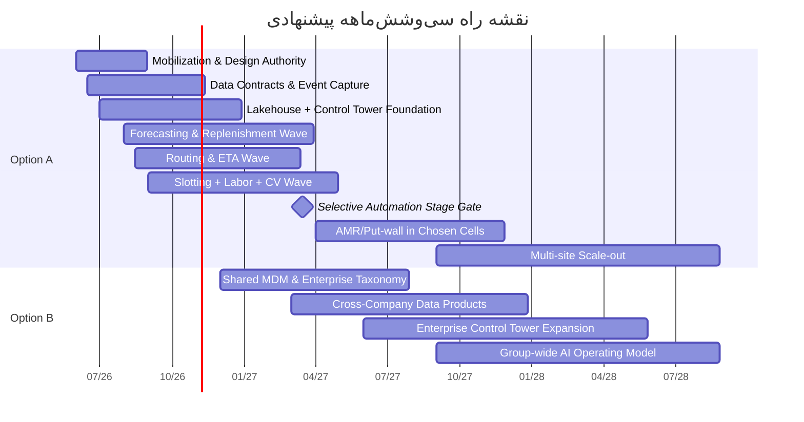

# گزارش یکپارچه تحول داده، هوش مصنوعی و اتوماسیون لجستیک برای افق کوروش، اکالا و اکوسیستم گلرنگ

## خلاصه مدیریتی

طبق صورت‌مسئله، این گزارش باید دو مسیر را هم‌زمان پوشش دهد: مسیر متمرکز و شش‌ماهه برای **افق کوروش + اکالا + انبارهای فعلی** و مسیر بزرگ‌تر برای **تحول کل اکوسیستم گلرنگ**؛ همچنین باید ده فایل مرجع را به‌عنوان **Version 0** بپذیرد. در پنجره فعلی، محتوای کامل همه آن ده فایل به‌صورت قابل‌استناد در دسترس نبود؛ بنابراین هرجا عدد داخلی لازم بوده و در منابع عمومی نیامده، آن را با برچسب **نامشخص** یا **سناریوی برآوردی** آورده‌ام. fileciteturn0file0

یافته اصلی این گزارش این است که **گزینه پیشنهادی برای تصمیم هیئت‌مدیره، Option A** است: یعنی ساخت «ستون فقرات داده، تصمیم‌گیری و اتوماسیون» برای افق کوروش، اکالا و شبکه انبارهای موجود، به‌گونه‌ای که در **شش ماه به وضعیت implementation-ready** برسد و سپس از ماه دوازدهم به بعد به‌صورت stage-gated به سمت Option B گسترش یابد. این توصیه به سه دلیل اصلی است:  
نخست، **زمان تا ارزش** در Option A بسیار کوتاه‌تر است و لایه‌های داده، پیش‌بینی، کنترل‌تاور، مسیرسازی و بهینه‌سازی عملیات را می‌توان بدون انتظار برای یکسان‌سازی کل هلدینگ به تولید رساند. دوم، **شدت CapEx و وابستگی به سخت‌افزار وارداتی** در Option A پایین‌تر و قابل‌کنترل‌تر است؛ این موضوع در محیط تورمی و محدودیت‌های تأمین ایران اهمیت مضاعف دارد. سوم، معماری پیشنهادی برای Option A — شامل Kafka، Spark، Iceberg، ClickHouse، Feast، MLflow، Kubernetes/K3s، MQTT، Redis و DataHub — ذاتاً **قابل‌گسترش به کل گلرنگ** است و از ابتدا باید با design authority مشترک ساخته شود، نه به‌عنوان یک راهکار موضعی. citeturn41view2turn16view0turn20view0turn13view2turn17view2turn18view0turn14view0turn29view1turn17view0turn20view3turn23view0turn26view0

از منظر مقیاس، خود گلرنگ در وب‌سایت رسمی‌اش اعلام می‌کند که **بیش از ۱۴۰ برند کالاهای تندمصرف، ۷۳ برند دارویی فعال و بیش از ۱۲۵ شرکت** در حوزه‌های تولید، بازرگانی و خدمات دارد؛ همچنین در بخش فناوری، شرکت‌هایی مانند گلرنگ سیستم، ویرا سیستم پویا، فاوافناوری افق و سایر واحدهای فناوری را فهرست کرده است. همین موضوع توضیح می‌دهد که چرا Option B بالقوه ارزش‌آفرینی بالاتری دارد، اما هم‌زمان از نظر حاکمیت داده، استانداردسازی فرایند، MDM و مدیریت تغییر نیز بسیار پیچیده‌تر است. citeturn41view2

برای هیئت‌مدیره، جمع‌بندی مالی این گزارش چنین است: در قیمت ثابت ۱۴۰۵، **Option A** یک برنامه ۳۶ماهه با اندازه تقریبی **۱,۳۰۰ تا ۲,۰۰۰ میلیارد تومان** است و در سناریوی پایه می‌تواند در بازه **۲۰ تا ۲۴ ماه** به نقطه سربه‌سر برسد. **Option B** در همان افق، برنامه‌ای حدود **۴,۲۰۰ تا ۶,۶۰۰ میلیارد تومان** است که در سناریوی پایه معمولاً **۳۰ تا ۳۴ ماه** تا سربه‌سر فاصله دارد. به زبان تصمیم سرمایه‌گذاری: Option B از نظر استراتژیک جذاب است، اما **برای شروع** ریسک یکپارچه‌سازی و فشار سرمایه‌ای آن نسبت به Option A بالاتر از حد بهینه است. این اعداد سناریویی‌اند و به دلیل نبود baseline مالی داخلی قطعی، باید در فاز design authority با داده‌های واقعی شبکه، SKU، OTIF، inventory turns، labor minutes، فروش منطقه‌ای و هزینه حمل کالیبره شوند. citeturn31news0turn31news2turn31news1turn38news1turn9academia1turn31academia9

از نظر محتوا، این گزارش هفت جلد محتوایی را پوشش می‌دهد: **راهبرد و case for change، بنچمارک جهانی، معماری هدف، اتوماسیون و سخت‌افزار، مشخصات مدل‌های AI، پایلوت‌های دوازده‌هفته‌ای، و مدل سرمایه‌گذاری/حاکمیت/نقشه راه**. توصیه اجرایی روشن است:  
**اکنون Option A را تصویب کنید؛ معماری و حاکمیت آن را از روز اول با قابلیت scale-out برای Option B طراحی کنید؛ و ورود به Option B را به عبور از gateهای ماه ششم و دوازدهم مشروط سازید.** fileciteturn0file0

| معیار تصمیم | Option A | Option B |
|---|---:|---:|
| زمان تا اولین ارزش عملیاتی | بالا | متوسط |
| پیچیدگی حاکمیت داده | متوسط | بسیار بالا |
| شدت CapEx سخت‌افزار | متوسط | بالا |
| آمادگی برای ۶ ماه | قوی | محدود |
| قابلیت reuse برای کل گلرنگ | بالا | بالا |
| ریسک اجرای ایران‌محور | کنترل‌پذیر | بالا |
| توصیه نهایی | **شروع فوری** | **فاز بعدی، stage-gated** |

## منطق تصمیم و فرض‌های کلیدی

### دامنه تصمیم و فرض‌های لازم

این گزارش بر این فرض بنا شده است که **سناریوی شش‌ماهه** به معنای «production foundation + pilots + first-wave rollout readiness» است، نه این‌که کل اتوماسیون مکانیزه سنگین در شش ماه کامل نصب شود. برای پرهیز از گمراهی، موارد زیر در وضعیت **نامشخص** قرار دارند و باید در فاز بعدی تکمیل شوند: تعداد دقیق SKUهای فعال، تعداد سفارش روزانه اکالا، تعداد خطوط آماده‌سازی و ایستگاه‌های picking، نرخ واقعی OOS، inventory days by category، الگوی cold chain، هزینه واقعی هر سفارش، سهم outsourcing حمل، و ظرفیت دقیق هر انبار. اعداد مالی این گزارش، بنابراین، **سناریومحور** هستند نه جایگزین budget book داخلی. fileciteturn0file0

### مقایسه راهبردی دو گزینه

**Option A** باید به‌عنوان «نقطه ورود کم‌ریسک اما با option value بالا» دیده شود. این گزینه با تمرکز بر شبکه‌ای که هم‌اکنون بیشترین اثر را بر تجربه مشتری، سرعت گردش موجودی و هزینه عملیات دارد، می‌تواند سه لایه ارزش بسازد:  
لایه اول، **visibility و decisioning** از طریق control tower؛  
لایه دوم، **AI operational** شامل forecasting، replenishment، slotting، ETA و labor orchestration؛  
لایه سوم، **selective automation** برای نقاط گلوگاهی انبارهای فعلی. این دقیقاً با الگوی جهانی موفق نیز هم‌راستا است: بسیاری از شرکت‌ها ابتدا از داده، تصمیم‌گیری و sensorization شروع کرده‌اند و بعد به سراغ mechanization سنگین رفته‌اند. Walmart به‌طور عمومی اعلام کرده است که تا پایان ۲۰۲۶ در کل زنجیره آمریکا از سنسورهای ردیابی برای ده‌ها میلیون پالت استفاده می‌کند، و هم‌زمان همکاری خود با Symbotic را برای اتوماسیون pickup/delivery توسعه داده است. citeturn31news0turn31news2turn31news5

**Option B** زمانی توجیه پیدا می‌کند که گلرنگ بخواهد از یک زنجیره retail/logistics data platform به یک **enterprise operating system** در کل اکوسیستم برسد؛ یعنی داده، فرایند، حاکمیت، کنترل‌تاور و MLOps را از retail و e-grocery به تولید، توزیع، خدمات مالی، سلامت و سایر شرکت‌های گروه تعمیم دهد. از آن‌جا که خود گلرنگ به‌صورت رسمی بر گستردگی شرکت‌ها، برندها و حوزه‌های فعالیتش تأکید می‌کند، روشن است که Option B نه صرفاً یک پروژه IT، بلکه یک **برنامه operating model transformation** است. بنابراین تصمیم درست، «رد کردن Option B» نیست؛ بلکه **تعویق هوشمندانه آن تا پس از اثبات Option A** است. citeturn41view2

### مجهولات باز تصمیم‌گیری

| دسته | مورد نامشخص | اثر بر تصمیم |
|---|---|---|
| داده | baseline دقیق OTIF، OOS، shrink، productivity | دقت ROI و payback |
| فرایند | variance بین انبارها و فروشگاه‌ها | دامنه استانداردسازی |
| فناوری | ERP/WMS/TMS فعلی و محدودیت API | effort یکپارچه‌سازی |
| مالی | هزینه سرمایه داخلی، FX policy، depreciation | NPV/IRR واقعی |
| منابع انسانی | ظرفیت تیم داده/مهندسی/عملیات | سرعت rollout |
| سخت‌افزار | lead time و دسترسی تأمین‌کنندگان | زمان‌بندی CapEx |

## جلد راهبردی و ارزش

### جلد راهبرد و case for change

برای افق کوروش و اکالا، مسئله اصلی صرفاً «نداشتن ابزار تحلیلی» نیست؛ مسئله، **نداشتن یک operating spine واحد** است که رویدادهای POS، سفارش آنلاین، موجودی، inbound، put-away، picking، dispatch، ETA و customer promise را در یک زنجیره تصمیم‌گیری هم‌زمان کند. در محیطی که تقاضا نوسانی، حاشیه‌ها فشرده، و فشار تورمی شدید است، سود عملیاتی بیشتر از محل **کاهش اتلاف، افزایش دقت تخصیص، کوتاه شدن lead time تصمیم، و بالا رفتن availability** خلق می‌شود تا از محل رشد فروش اسمی. پژوهش‌های جدید موجودی چندسطحی نشان می‌دهند که ارزیابی مدل‌های پیش‌بینی باید بر اساس **inventory cost و service level** انجام شود، نه صرفاً MAE/MAPE؛ و تجربه‌های عملی در retail supply chain نیز نشان می‌دهد که اتوماسیون workflow و تصمیم‌سازی عامل‌محور، لایه coordination را مقیاس‌پذیر می‌کند. citeturn31academia9turn31academia7

از نظر سازوکارهای ارزش، چهار استخر اصلی برای Option A وجود دارد:  
**موجودی و سرمایه در گردش** از طریق پیش‌بینی احتمالاتی، تخصیص و replenishment؛  
**بهره‌وری انبار** از طریق slotting، wave/cluster picking، vision و labor orchestration؛  
**حمل و fulfilment** از طریق route optimization و ETA؛  
و **fruitful data reuse** برای pricing، promotion و assortment در اکالا و افق کوروش. ابزارهای عملیاتی مدرن مانند Odoo و ERPNext نیز به‌صراحت روی replenishment، route planning، wave/batch picking، and stock optimization تأکید می‌کنند، هرچند برای enterprise-scale باید بیشتر به‌عنوان reference capability دیده شوند تا هسته نهایی معماری. citeturn33view0turn34view1

### استخرهای ارزش مالی

مقادیر زیر **برآورد سناریویی این گزارش** هستند و باید با Version 0 واقعی کالیبره شوند:

| استخر ارزش | اهرم عملیاتی | دامنه اثر سناریویی در Option A | دامنه اثر سناریویی در Option B |
|---|---|---:|---:|
| سرمایه در گردش | کاهش days of inventory / safety stock | ۶٪ تا ۱۰٪ | ۸٪ تا ۱۵٪ |
| بهره‌وری انبار | کاهش travel time، wave quality، labor minutes/order | ۱۰٪ تا ۱۸٪ | ۱۲٪ تا ۲۵٪ |
| حمل و آخرین‌مایل | route quality، drop density، ETA accuracy | ۵٪ تا ۹٪ | ۶٪ تا ۱۲٪ |
| availability و sales uplift | OOS کمتر، promise accuracy بهتر | ۱٪ تا ۲٪ فروش در دامنه منتخب | ۱.۵٪ تا ۳٪ فروش در دامنه گسترده |
| ضایعات و خطا | shrink، miss-pick، returnable loss | ۸٪ تا ۱۵٪ | ۱۰٪ تا ۲۰٪ |

### ده ابتکار اولویت‌دار با امتیاز ROI

امتیاز زیر یک **ROI Score ترکیبی از ۱۰۰** است که بر پایه پنج عامل این گزارش ساخته شده: اندازه استخر ارزش، سرعت تا ارزش، آمادگی داده، شدت CapEx، و تناسب با حاکمیت و استقلال فناوری.

| رتبه | ابتکار | شرح | ROI Score | اولویت در Option A | اولویت در Option B |
|---|---|---|---:|---|---|
| بالا | پیش‌بینی احتمالاتی و replenishment | forecast چندافقی + سفارش‌گذاری + exception management | ۹۲ | فوری | فوری |
| بالا | control tower رویدادمحور | visibility یکپارچه POS/order/inventory/inbound/outbound | ۸۹ | فوری | فوری |
| بالا | slotting و pick-path optimization | ABC پویا، wave/cluster/batch، heatmap مسیر | ۸۶ | فوری | فوری |
| بالا | route optimization و ETA | multi-drop routing، batching، customer promise | ۸۴ | فوری | بالا |
| بالا | vision برای دریافت، شمارش و compliance | OCR-less CV، pallet/tote/counting، exception | ۸۰ | بالا | بالا |
| بالا | labor management و wave orchestration | برنامه‌ریزی شیفت، تخصیص کار، bottleneck control | ۷۸ | بالا | بالا |
| متوسط به بالا | MDM و product-location graph | کاتالوگ محصول، مکان، BOM/pack/temperature class | ۷۷ | بالا | فوری |
| متوسط به بالا | supplier fill-rate و inbound appointment optimization | پنجره تحویل، تأخیر، dock utilization | ۷۴ | بالا | بالا |
| متوسط | price/promo/assortment analytics برای اکالا و افق | elasticity، uplift، markdown guardrails | ۷۲ | متوسط | بالا |
| متوسط | selective automation در high-velocity cells | AMR/G2P/put-wall فقط در گلوگاه‌ها | ۶۸ | stage-gated | بالا |

**نکته مهم برای هیئت‌مدیره:** ابتکار دهم عمداً در رتبه پایین‌تری نسبت به data/AI initiatives قرار گرفته است، نه چون بی‌ارزش است، بلکه چون در ایران و در فاز نخست، **CapEx، lead time و import dependence** آن بیشتر است. تجربه Ocado نیز نشان می‌دهد که اتکای زودهنگام به مدل‌های بسیار متمرکز و سخت‌افزار-سنگین در بازارهایی با density ضعیف یا economics نامطمئن، می‌تواند rollout را کند یا حتی معکوس کند. citeturn31news1turn38news1turn38news2

## جلد بنچمارک و معماری

### جلد بنچمارک جهانی و درس‌های قابل‌انتقال

جدول زیر ده benchmark مرجع را در دو دسته می‌بیند: **اپراتورهای عملیاتی** و **vendor/platform benchmarks**. هرجا جزئیات فنی عمومی محدودتر بوده، آن را صریحاً ذکر کرده‌ام.

| بنچمارک | pattern مشاهده‌شده | درس فنی/عملیاتی | ترجمه ایران‌محور | شواهد |
|---|---|---|---|---|
| Amazon | robotics at scale، tactile robotics، next-gen FC | robot-first اما با human-in-the-loop و continuous model learning | برای ایران: full-Amazon تقلید نشود؛ picking assist + CV + selective AMR کافی است | citeturn5news1turn6news2turn38news0turn38news3turn5academia6 |
| Walmart + Symbotic | sensorized pallets + DC automation + store fulfillment | از sensorization و data plane شروع، سپس robotics scale-up | برای افق/اکالا: سنسور و inbound visibility قبل از AS/RS سراسری | citeturn31news0turn31news2turn31news5 |
| Ocado | centralized robotic CFC + last-mile software | density economics حیاتی است؛ rollout باید location-specific باشد | برای اکالا: hub-and-spoke + store-assisted hybrid بهتر از mega-CFC از روز اول | citeturn31news1turn38news1turn38news2 |
| JD Logistics | integrated assortment + allocation + large-scale warehouse AI | forecasting، allocation و simulation باید یک زنجیره واحد باشند | برای افق/اکالا: RDC-FDC logic و local fulfillment بسیار مهم است | citeturn9academia1 |
| Cainiao | address intelligence + large last-mile datasets | address embedding و ETA/dispatch AI مزیت برجسته می‌سازند | برای ایران: مدل‌سازی آدرس فارسی و geospatial cleaning باید سرمایه‌گذاری اول باشد | citeturn38academia9turn38academia10turn38news4 |
| Dematic | end-to-end automation stack شامل AGV/AMR/ASRS/robotic picking/software | systems integration و software control به اندازه سخت‌افزار مهم است | برای ایران: integrator-neutral design و modular procurement | citeturn36view1 |
| Kafka-centric digital enterprises | event streaming + durable storage + exactly-once processing | data plane رویدادمحور prerequisite کنترل‌تاور است | برای ایران: POS/order/inventory باید event-native شوند | citeturn16view0 |
| Lakehouse adopters بر پایه Iceberg + Spark | open table format + serializable isolation + multi-engine analytics | lock-in را کم می‌کند و هم‌زمان batch/stream را به یک مدل می‌رساند | برای ایران: sovereign analytics بدون اتکا به cloud خارجی | citeturn13view2turn20view0 |
| Feature-store/MLOps adopters | offline/online features + point-in-time correctness + lifecycle mgmt | production ML بدون feature discipline و registry پایدار نمی‌ماند | برای ایران: build models once, serve everywhere | citeturn18view0turn14view0 |
| K3s/Kubernetes edge adopters | lightweight edge orchestration + air-gapped feasibility | edge inference و OT/IT bridge باید کم‌مصرف و resilient باشد | برای انبارهای ایران: edge cluster سبک، نه cloud-first | citeturn17view0turn15academia4turn29view1 |

**نتیجه بنچمارک‌ها:** برد قابل‌انتقال برای ایران این نیست که «بیشترین ربات را بخریم». برد واقعی این است که **data plane + decision plane + selective mechanization** را به‌ترتیب پیاده کنیم. Ocado به ما درس محدودیت economics می‌دهد؛ Walmart درس sensorization و flows؛ Amazon درس robotics-assisted learning؛ JD و Cainiao درس optimization و address/fulfillment intelligence. citeturn31news0turn38news1turn9academia1turn38academia10

### جلد معماری هدف

معماری پیشنهادی این گزارش، یک **lakehouse event-driven sovereign architecture** است. نقش اجزا به‌اختصار چنین است:  
Kafka، ستون رویداد و integration fabric برای POS، OMS، WMS، TMS، ERP و IoT؛  
Spark، موتور پردازش batch/stream و feature engineering؛  
Iceberg روی object storage، لایه داده تحلیلی باز با serializable isolation و optimistic concurrency؛  
ClickHouse، لایه real-time analytics برای control tower و alerting؛  
Feast، feature store با offline/online separation و point-in-time retrieval؛  
MLflow، experiment tracking، registry و deployment metadata؛  
Kubernetes در مرکز و K3s در لبه، برای orchestration و edge deployment؛  
Airflow برای batch workflows و backfills؛  
Redis برای low-latency serving/cache/streams برخی سرویس‌ها؛  
MQTT برای sensor/edge messaging؛  
DataHub برای metadata graph، lineage و data contracts؛  
Grafana برای observability و operational dashboards؛  
FastAPI برای service layer استاندارد و OpenAPI-first. این stack از نظر فنی با اسناد رسمی همه اجزای اصلی قابل‌پشتیبانی است. citeturn16view0turn20view0turn13view2turn17view2turn18view0turn14view0turn29view1turn17view0turn19view2turn23view0turn20view3turn26view0turn29view2turn17view3

```mermaid
flowchart TD
    A[POS / فروشگاه‌ها] --> K[Kafka Event Bus]
    B[OMS / اکالا] --> K
    C[ERP / مالی و تأمین] --> K
    D[WMS / TMS] --> K
    E[IoT / RFID / CCTV / PLC] --> M[MQTT Edge Broker]
    M --> K

    K --> S[Spark Streaming & Batch]
    S --> I[Iceberg Tables on Object Storage]
    S --> Ck[ClickHouse Real-Time Mart]
    I --> F[Feast Offline Store]
    Ck --> Fo[Feast Online Store / Redis]

    I --> Dh[DataHub / Catalog / Lineage]
    S --> Ml[MLflow / Registry / Eval]
    F --> X[Model Training]
    Fo --> Y[Model Serving APIs]
    Ml --> Y
    Y --> Z[FastAPI Services]
    Z --> Ct[Control Tower]
    Z --> W[WMS/TMS Decision APIs]
    Z --> O[Okala / Ops Apps]

    subgraph Core Platform
      K
      S
      I
      Ck
      F
      Fo
      Ml
      Dh
      Z
    end

    subgraph Runtime
      K8s[Kubernetes Central]
      K3s[K3s Edge Clusters]
    end

    Core Platform --> K8s
    E --> K3s
    K3s --> M
```

### Build vs Buy

این گزارش **مدل Hybrid-by-layer** را توصیه می‌کند:

| لایه | تصمیم پیشنهادی | منطق |
|---|---|---|
| ERP/WMS/TMS تراکنشی | **Buy / Hybrid** | فرایندهای پایه، auditability و vendor support مهم‌اند |
| data plane و lakehouse | **Build on open stack** | sovereignty، کاهش lock-in، reuse بین شرکت‌ها |
| forecasting / replenishment / routing models | **Build** | تمایز رقابتی، بومی‌سازی ایران، بهینه‌سازی روی داده واقعی |
| metadata, lineage, observability | **Adopt open platforms** | سرعت استقرار و استانداردسازی |
| robotics / ASRS / AMR | **Buy from integrators** | IP اصلی در orchestration و data layer است، نه تولید سخت‌افزار |
| dashboards و control tower UX | **Build-Hybrid** | UI باید دقیقاً با عملیات افق/اکالا match شود |

برای واحدهای کوچک‌تر یا satellite ops، قابلیت‌های Odoo در replenishment، routing، wave/cluster/batch picking و barcode workflows و نیز ERPNext در stock module ارزش دارند، اما برای هسته Option B ــ در مقیاس enterprise گلرنگ ــ این گزارش آن‌ها را بیشتر به‌عنوان **reference capability** و گزینه subsidiary-grade می‌بیند تا transaction backbone نهایی. citeturn33view0turn34view1

## جلد عملیاتی و فنی

### جلد اتوماسیون، سخت‌افزار و نرم‌افزار عملیاتی

اصل سیاست فنی این گزارش این است که **از automation-light به automation-selective و سپس automation-heavy** حرکت شود. برای Option A، انبارهای فعلی باید ابتدا با visibility، slotting، labor orchestration، handheld discipline، pick path، CV exception handling و docking intelligence بهینه شوند. سپس فقط در cellهای high-velocity یا labor-constrained به سراغ AMR/G2P/put-wall برویم. راهکارهای Dematic نشان می‌دهند که software control, inventory visibility و fulfillment accuracy باید هم‌زمان با transport, storage و robotic picking دیده شوند؛ و نه جدا از آن‌ها. citeturn36view1

| فناوری | مورد استفاده پیشنهادی | CapEx نسبی | OpEx نسبی | ROI محتمل در ایران | اولویت |
|---|---|---:|---:|---|---|
| Handheld + barcode discipline | receipt, put-away, cycle count, pick confirm | پایین | پایین | بسیار بالا | فوری |
| Pick path + wave/cluster/batch software | انبارهای فعلی | پایین | پایین | بسیار بالا | فوری |
| Computer vision counting / exception | receiving, pallet check, shelf/bin audit | پایین تا متوسط | متوسط | بالا | فوری |
| RFID موردی | cold chain / high-value / reusable asset | متوسط | متوسط | متوسط؛ فقط در use-case روشن | انتخابی |
| Pick-to-light / put-wall | fast-moving e-grocery zones | متوسط | متوسط | بالا در zoneهای پرحجم | بالا |
| AMR tote/cart assist | long walking distances, person-to-goods | متوسط تا بالا | متوسط | بالا در انبارهای بزرگ موجود | stage-gated |
| AGV pallet moves | repeatable pallet lanes, dock-to-buffer | بالا | متوسط | متوسط تا بالا | انتخابی |
| Mini-load / shuttle / G2P | dense small-item fulfilment | بالا | متوسط تا بالا | بالا فقط در volume پایدار | بعد از اثبات |
| AS/RS pallet | space-density bottleneck، network maturity | بسیار بالا | متوسط | فقط در Option B یا great brownfield need | دیرتر |
| Digital twin | simulation, throughput design, capex staging | پایین تا متوسط | پایین | بالا برای جلوگیری از خطای سرمایه‌گذاری | بالا |

**ترتیب اجرایی توصیه‌شده:**  
Wave نخست: barcode discipline + control tower + slotting + routing + CV؛  
Wave دوم: put-wall / pick-to-light / AMR assist؛  
Wave سوم: AS/RS یا shuttle فقط اگر throughput، SKU profile و site permanence به‌اندازه کافی اثبات شده باشد. پژوهش‌های recent digital twin نیز نشان می‌دهند که قبل از قفل شدن CapEx سنگین، simulation و test architecture می‌تواند fidelity تصمیم را بالا ببرد و هزینه خطای طراحی را کم کند. citeturn32academia4turn32academia5

### جلد مشخصات مدل‌های AI

#### مدل پیش‌بینی تقاضا و replenishment

**هدف:** پیش‌بینی probabilistic در سطح `SKU × location × day` با افق‌های ۱، ۷، ۱۴ و ۲۸ روز.  
**ویژگی‌ها:** فروش، موجودی، قیمت، promo flag، تعطیلات، weather proxy اگر در دسترس باشد، lead time supplier، lost-sales proxy، freshness class، temperature class.  
**مدل پیشنهادی:** ensemble دو لایه:  
مدل پایه gradient boosting / tabular global model برای robustness،  
به‌علاوه sequence model برای seasonality و promo interaction.  
**تابع خطا:** quantile loss برای qهای پایین/میانه/بالا تا policy موجودی به‌جای point forecast از band uncertainty استفاده کند:

\[
\mathcal{L}_{forecast}=\sum_{q \in \{0.1,0.5,0.9\}} \rho_q(y-\hat{y}^{(q)})
\]

**سیاست سفارش‌گذاری:**  
\[
ROP = \mu_d L + z_\alpha \sqrt{L \sigma_d^2 + \mu_d^2 \sigma_L^2}
\]
که در آن \(L\) lead time و \(z_\alpha\) سطح خدمت هدف است.  
این رویکرد با یافته‌های اخیر inventory-cost-aware evaluation و نیز caseهای عملیاتی بزرگ retail کاملاً هم‌راستاست. citeturn31academia9turn9academia1

#### مدل slotting و orchestration انبار

**هدف:** کمینه‌سازی travel distance، congestion و touches.  
**متغیرها:** `sku_velocity`, `cube`, `temperature_zone`, `affinity`, `pick_frequency`, `replen_cycle`, `worker_path_density`.  
**فرم بهینه‌سازی:**

\[
\min \sum_{s,l} x_{s,l}(f_s d_l + \beta c_l + \gamma r_s)
\]

که در آن \(f_s\) فرکانس برداشت SKU، \(d_l\) فاصله موقعیت، \(c_l\) congestion score و \(r_s\) replenishment burden است. برای wave orchestration و human-robot coordination می‌توان از heuristics + search، و در سطح پیشرفته‌تر از MARL/learn-then-optimize استفاده کرد. پژوهش‌های Amazon Robotics و MARL انباری نشان داده‌اند که coordination هوشمند، throughput را نسبت به heuristics بهبود می‌دهد. citeturn5academia6turn38academia11

#### مدل routing و ETA

**هدف:** بهینه‌سازی dispatch، route sequencing و promise accuracy.  
**هسته حل:** OR-Tools برای VRP با ظرفیت، time window و penalties؛  
**ویژگی‌ها:** geocode پاک‌شده، traffic proxy، customer time preference، courier skill, stop density.  
**مسئله هدف:**

\[
\min \sum_{v}\sum_{i,j} c_{ij}x_{ijv} + \lambda \sum tardiness + \eta \sum dropped\_stops
\]

OR-Tools به‌صورت رسمی برای VRP، ظرفیت و time windows مستندسازی شده است و برای این لایه کاملاً مناسب است. برای ایران، مزیت ویژه در **address normalization فارسی** است؛ تجربه Cainiao در address representation و datasets last-mile نشان می‌دهد که این لایه می‌تواند اثر زیادی بر ETA و dispatch quality داشته باشد. citeturn30view0turn38academia9turn38academia10

#### مدل computer vision برای دریافت و شمارش

**کاربری‌ها:** pallet verification، tote counting، label/lot compliance، dock anomaly detection، cycle count assist.  
**مدل‌ها:** detection + segmentation + OCR-free classification.  
**تابع خطا:** focal loss برای detection و dice/CE برای segmentation:

\[
FL(p_t)=-\alpha_t(1-p_t)^\gamma \log(p_t)
\]

**failover:** اگر confidence زیر آستانه باشد، task به handheld confirmation یا image review queue برگردد.  
**serving:** edge inference روی nodeهای محلی با K3s و publish رویدادها از طریق MQTT/Kafka. lightweight edge و air-gapped suitability برای این طراحی مهم است. citeturn17view0turn15academia4turn20view3

#### schema داده و MLOps

حداقل schema مشترک پیشنهادی:

| موجودیت | فیلدهای حداقلی |
|---|---|
| Product | sku_id, category, brand, unit, cube, weight, temp_class, shelf_life |
| Location | loc_id, type, region, warehouse/store, zone, aisle, bin |
| Inventory | sku_id, loc_id, on_hand, available, reserved, lot, expiry |
| Order | order_id, channel, create_ts, promise_ts, customer_zone |
| OrderLine | order_id, sku_id, qty, picked_qty, substitute_flag |
| MovementEvent | ts, event_type, sku_id, from_loc, to_loc, user/device |
| DeliveryStop | route_id, stop_seq, eta, ata, distance, courier_id |
| SupplierShipment | po_id, supplier_id, planned_arrival, actual_arrival, fill_rate |

از نظر MLOps، Feast به‌صورت رسمی offline/online feature architecture و point-in-time correctness را پوشش می‌دهد و MLflow برای experiment tracking، registry management و deployment metadata مناسب است. DataHub نیز برای schema-first metadata graph، entities/aspects/relationships و lineage انتخاب مناسبی است. در production، همه مدل‌ها باید **champion/challenger**، **fallback rule engine**، و **last-known-good model** داشته باشند. citeturn18view0turn14view0turn26view0

## جلد پایلوت‌ها و حکمرانی

### جلد پایلوت‌های دوازده‌هفته‌ای

سه پایلوت زیر برای Option A طراحی شده‌اند و هر سه باید به یک data plane مشترک متصل باشند؛ نه این‌که جزایر جداگانه باشند.

| پایلوت | دامنه | مدت | بودجه سناریویی | تیم | KPIهای تصمیم | gate ادامه |
|---|---|---:|---:|---|---|---|
| پایلوت پیش‌بینی و replenishment | ۳ تا ۵ دسته پرگردش، ۱ DC، ۵۰ تا ۱۰۰ فروشگاه یا hub | ۱۲ هفته | ۳۵ تا ۵۵ میلیارد تومان | product owner عملیات، data scientist، data engineer، supply planner، BI | forecast bias، stockout rate، inventory days، service level | حداقل ۱۵٪ کاهش OOS یا ۵٪ کاهش inventory days |
| پایلوت انبار هوشمند | ۱ انبار منتخب، slotting + pick path + CV receiving | ۱۲ هفته | ۶۰ تا ۹۵ میلیارد تومان | warehouse lead، IE، CV engineer، MLOps، WMS engineer | lines/hour، travel meters/order، receiving accuracy، miss-pick | حداقل ۱۰٪ افزایش productivity و ۲۰٪ کاهش exception handling time |
| پایلوت route/ETA/control tower | ۱ منطقه توزیع، ۱۰۰ تا ۳۰۰ مسیر روزانه | ۱۲ هفته | ۴۵ تا ۷۵ میلیارد تومان | transport lead، OR engineer، backend/API، ops analyst | on-time rate، km/drop، reattempts، ETA MAE | حداقل ۵٪ کاهش cost/drop و ۲۰٪ بهبود ETA accuracy |

**طراحی اجرایی پایلوت‌ها:**  
هفته‌های نخست باید صرف data contract، event capture، metrics baseline و manual shadow mode شود؛  
هفته‌های میانی برای model training و closed-loop simulation؛  
و هفته‌های پایانی برای A/B rollout یا region split.  
برای هر پایلوت، decision gate باید مالی-عملیاتی باشد، نه صرفاً «accuracy». این اصل با ادبیات اخیر cost-aware forecasting و workflow automation هم‌سو است. citeturn31academia9turn31academia7

### جلد حاکمیت، ریسک و کنترل

حاکمیت پیشنهادی برای Option A شامل پنج سازوکار است:  
**SteerCo هیئت‌مدیره/مدیریت ارشد** برای value realization؛  
**Transformation PMO** برای cadence هفتگی و monthly business review؛  
**Architecture Review Board** برای استانداردهای داده و integration؛  
**Data & Model Council** برای تعریف feature ownership، SLO و model risk؛  
و **OT/IT Security Council** برای segmentation، access control و resilience.  
به‌ویژه با توجه به این‌که حتی بازیگران بزرگ نرم‌افزار زنجیره تأمین مانند Blue Yonder در سال ۲۰۲۴ با حمله ransomware مواجه شدند، جدا نگه‌داشتن runtime عملیاتی، registry، backup و deployment lanes اهمیت بالایی دارد. citeturn35search0

| ریسک | شدت | کنترل پیشنهادی |
|---|---|---|
| داده ناپاک و master data ضعیف | بسیار بالا | MDM مرحله‌ای، owner مشخص برای product/location/supplier |
| ناهماهنگی فرایند بین سایت‌ها | بالا | standard work + process mining + local exceptions registry |
| قفل‌شدن به vendor خاص | بالا | open formats، API-first، Iceberg/Kafka-centric core |
| تورم و جهش هزینه سخت‌افزار | بالا | modular procurement، stage gates، local-first sequencing |
| شکست adoption عملیاتی | بالا | shadow mode، scorecards، incentive alignment |
| drift مدل‌ها | متوسط تا بالا | monitoring، champion/challenger، replay datasets |
| ریسک امنیت سایبری | بالا | network segmentation، immutable backup، least privilege |
| طولانی شدن integration | بالا | anti-corruption layer و event contracts از روز اول |
| دقت پایین address/ETA | متوسط | Persian address graph و manual correction loop |
| overspend در automation سنگین | بالا | الزام digital twin و ROI gate پیش از هر CapEx سنگین |

## جلد مالی و نقشه راه

### جلد مدل سرمایه‌گذاری سه‌ساله

تمام ارقام زیر **برآورد سناریویی این گزارش** در **میلیارد تومان قیمت ثابت ۱۴۰۵** هستند و VAT، شوک‌های شدید ارزی و هزینه خرید زمین/ساختمان جدید را پوشش نمی‌دهند.

| فاز | Option A CapEx | Option A OpEx | Option B CapEx | Option B OpEx |
|---|---:|---:|---:|---:|
| بنیاد و شش‌ماهه نخست | ۲۲۰ تا ۳۴۰ | ۹۰ تا ۱۴۰ | ۳۲۰ تا ۵۰۰ | ۱۶۰ تا ۲۵۰ |
| گسترش موج نخست | ۳۶۰ تا ۵۴۰ | ۱۵۰ تا ۲۴۰ | ۱,۱۰۰ تا ۱,۷۰۰ | ۳۸۰ تا ۶۰۰ |
| گسترش موج دوم | ۲۸۰ تا ۴۲۰ | ۲۰۰ تا ۳۲۰ | ۱,۵۰۰ تا ۲,۴۰۰ | ۷۰۰ تا ۱,۱۰۰ |
| جمع کل | **۸۶۰ تا ۱,۳۰۰** | **۴۴۰ تا ۷۰۰** | **۲,۹۲۰ تا ۴,۶۰۰** | **۱,۲۴۰ تا ۱,۹۵۰** |
| کل برنامه | **۱,۳۰۰ تا ۲,۰۰۰** |  | **۴,۲۰۰ تا ۶,۶۰۰** |  |

### حساسیت تورمی و سناریوهای ROI

فرض این تحلیل آن است که حدود ۴۰٪ از هزینه‌ها در ماه‌های ابتدایی commit می‌شود و بقیه هزینه‌ها در ۳۶ ماه پخش هستند. در نتیجه اثر تورم اسمی کمتر از تورم ساده خطی خواهد بود، اما همچنان معنادار می‌ماند.

| سناریو | Option A کل اسمی | Option B کل اسمی | توضیح |
|---|---:|---:|---|
| قیمت ثابت | ۱,۳۰۰ تا ۲,۰۰۰ | ۴,۲۰۰ تا ۶,۶۰۰ | baseline تحلیلی |
| تورم ۳۰٪ | ۱,۵۵۰ تا ۲,۳۸۰ | ۵,۰۲۰ تا ۷,۹۰۰ | در procurement مرحله‌ای |
| تورم ۵۰٪ | ۱,۷۲۰ تا ۲,۷۰۰ | ۵,۵۸۰ تا ۹,۰۰۰ | در lead time طولانی‌تر و import-heavy |

| ROI scenario | Option A نتیجه سناریویی | Option B نتیجه سناریویی |
|---|---|---|
| محافظه‌کارانه | payback حدود ۲۷ تا ۳۰ ماه | payback حدود ۳۶ تا ۴۰ ماه |
| پایه | payback حدود ۲۰ تا ۲۴ ماه | payback حدود ۳۰ تا ۳۴ ماه |
| تهاجمی | payback حدود ۱۶ تا ۱۹ ماه | payback حدود ۲۵ تا ۲۹ ماه |

**توصیه مالی هیئت‌مدیره:** Option A تنها گزینه‌ای است که هم با mandate شش‌ماهه سازگار است، هم در تورم ۳۰٪ تا ۵۰٪ همچنان معقول می‌ماند، و هم امکان «option to expand» به Option B را حفظ می‌کند. Option B را باید به‌عنوان **Wave Two at enterprise scale** به تصویب مشروط رساند، نه به‌عنوان kickoff wave. citeturn41view2turn31news0turn31news1turn31news2

### جلد نقشه راه پیاده‌سازی



### اقدام‌های بعدی پیشنهادی

اگر این گزارش مبنای تصمیم هیئت‌مدیره باشد، سه اقدام بعدی باید بدون تأخیر آغاز شوند:  
**نخست، Design Authority شصت‌روزه** برای قفل‌کردن baseline، data contracts، KPI dictionary و site selection.  
**دوم، انتخاب یک DC و یک region نمونه** برای سه پایلوت دوازده‌هفته‌ای.  
**سوم، RFP محدود و modular** برای سه دسته vendor: integration/implementation، selective automation، و control tower visualization.  
این سه اقدام باید در Option A تصویب شوند؛ اما همه artefactهای آن‌ها ــ taxonomy، APIs، metadata model، event contracts، model registry policy ــ باید از روز اول با قابلیت reuse برای Option B طراحی شوند. citeturn26view0turn16view0turn13view2turn18view0turn14view0

## پیوست‌ها

### پیوست فرض‌ها و محدودیت‌ها

این گزارش به‌طور شفاف بر چند فرض استوار است:  
محتوای Version 0 داخلی به‌صورت کامل در این پنجره قابل‌استناد نبود؛  
baselineهای مالی و عملیاتی داخلی نامشخص‌اند؛  
بخش قابل‌توجهی از ROI به کیفیت اجرای process discipline وابسته است، نه صرفاً خرید فناوری؛  
و برخی داده‌های benchmark جهانی در حوزه عملیات انبار از **خلاصه‌های عمومی، گزارش‌های رسانه‌ای معتبر و مقالات علمی** به‌دست آمده‌اند، نه همیشه از filingهای کامل شرکت‌ها. بنابراین، این سند برای **تصمیم راهبردی و stage-gating** مناسب است، اما برای **approval budget نهایی** باید با workbook داخلی تکمیل شود. fileciteturn0file0

### پیوست فهرست منابع منتخب

**منابع رسمی و اولیه فناوری**  
- وب‌سایت رسمی گلرنگ برای ساختار گروه، تعداد برندها/شرکت‌ها و حوزه‌های کسب‌وکار. citeturn41view2  
- Apache Kafka docs برای event streaming، durability و exactly-once. citeturn16view0  
- Apache Spark docs برای unified analytics، Structured Streaming و Kubernetes deployment. citeturn20view0  
- Apache Iceberg docs برای open table format، serializable isolation و optimistic concurrency. citeturn13view2  
- Feast docs برای offline/online feature store و point-in-time correctness. citeturn18view0  
- MLflow docs برای experiment tracking، registry management و deployment lifecycle. citeturn14view0  
- Kubernetes docs برای portability، scaling و failover. citeturn29view1  
- K3s docs برای lightweight/edge/air-gapped deployment. citeturn17view0  
- Airflow docs برای workflow orchestration و تفکیک batch از streaming. citeturn19view2  
- Redis docs برای streams, time series, vector sets و low-latency patterns. citeturn23view0  
- MQTT.org برای lightweight pub/sub و QoS در IoT. citeturn20view3  
- DataHub docs برای metadata model و lineage graph. citeturn26view0  
- Grafana docs برای observability و dashboards. citeturn29view2turn29view3  
- FastAPI docs برای high-performance API و OpenAPI-first services. citeturn17view3turn17view4  
- Odoo Inventory و ERPNext Stock docs برای reference capabilities در WMS-grade features. citeturn33view0turn34view1  
- Dematic official solutions overview برای AMR/AGV/ASRS/robotic picking/software stack. citeturn36view1

**منابع benchmark و بازار**  
- Reuters, FT, WSJ و Guardian درباره Walmart/Symbotic، pallet sensorization و Ocado/Kroger. citeturn31news0turn31news2turn31news5turn31news1turn38news1turn38news2  
- AP, Business Insider, The Verge و AP/Reuters summaries درباره Amazon robotics/Vulcan و Cainiao strategy. citeturn6news2turn38news0turn38news3turn38news4

**منابع آکادمیک و فنی تازه**  
- Amazon Robotics learn-then-optimize paper for robotic warehousing operations. citeturn5academia6  
- JD integrated assortment and inventory allocation paper. citeturn9academia1  
- Flowr paper درباره agentic AI در زنجیره تأمین retail supermarket. citeturn31academia7  
- Beyond Accuracy paper برای cost-aware forecasting and inventory evaluation. citeturn31academia9  
- Cainiao LaDe dataset و G2PTL برای last-mile و address intelligence. citeturn38academia9turn38academia10  
- MARL paper برای warehouse logistics with robotic and human co-workers. citeturn38academia11  
- Digital twin testing and collaborative twin case papers. citeturn32academia4turn32academia5

### جمع‌بندی نهایی برای تصمیم هیئت‌مدیره

اگر هدف، **یک integrated report board-ready و implementation-grounded** باشد، توصیه نهایی این گزارش روشن است:  
**Option A را همین الآن تصویب کنید؛ Option B را به‌عنوان مسیر توسعه سازمانی بعدی نگه دارید.**  
به‌عبارت دیگر، افق کوروش + اکالا + انبارهای فعلی باید سکوی اثبات ارزش، بلوغ داده و discipline اجرایی شوند؛ و همان سکو، وقتی KPIهای موج نخست را گرفت، باید به operating system کل گلرنگ ارتقا یابد. این تصمیم، هم از نظر ارزش اقتصادی و هم از نظر ریسک اجرایی، در زمینه ایران انتخاب بهینه‌تری است. citeturn41view2turn31news0turn31news1turn31academia9